<div align="center">
  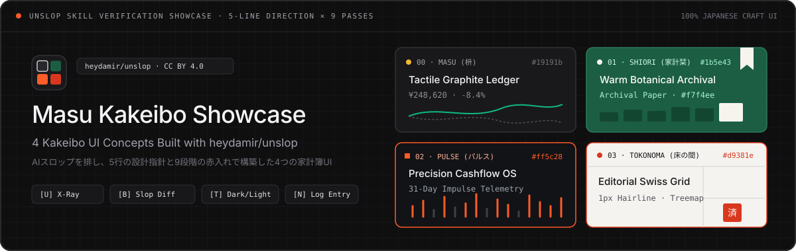

  # Unslop Kakeibo Showcase — 4つの家計簿UIデザイン検証ショーケース

  **UIデザインスキル [`heydamir/unslop`](https://github.com/heydamir/unslop) の実践検証リポジトリ — 同一の家計簿データを「5行の設計指針（5-Line Direction）」と「9段階の赤入れ（9 Passes）」によって、AIスロップの一切ない4つの純日本語クラフトUIへ昇華させたショーケース。**

  <p>
    <a href="https://Sunwood-ai-labs.github.io/unslop-kakeibo-showcase/"></a>
    <a href="https://github.com/Sunwood-ai-labs/unslop-kakeibo-showcase/actions/workflows/deploy-docs.yml"></a>
    
    <a href="./LICENSE"></a>
    <a href="https://github.com/heydamir/unslop"></a>
  </p>

  <p>
    <a href="./README.md">English</a> · <strong>日本語 (Japanese)</strong>
  </p>
</div>

---

## 🎯 概要

**Unslop Kakeibo Showcase** は、[Damir Sokolovsky (@heydamir)](https://x.com/heydamir) 氏が公開したUIデザインスキル **[`heydamir/unslop`](https://github.com/heydamir/unslop)** の実践検証リポジトリです。`unslop` は、AIが生成しがちな典型的な悪癖（AIスロップ：紫やシアンのネオングラデーション、光る枠線、絵文字だらけの見出し、意味のないミニスパークライン、煽り文句）を体系的に排除し、プロダクト固有の手触りと規律を備えたUIを構築するための手法を定めています。

本プロジェクトでは、2026年10月の家計簿データ（月次支出 `¥248,620`・5つの予算費目・19件の入出金明細）という単一の共通データセットを題材に、**「厳格なデザイン規律は画一的なテンプレートを生むのではなく、むしろコンセプトごとの個性を際立たせる」**ことを実証しました。各コンセプトに固有の **5-Line Direction**（`Product`, `Character`, `World`, `2 Moments`, `Signature`）を定義し、**9つの赤入れ工程（9 Passes）**を徹底することで、同じ機能を持つ家計簿アプリを4つの異なる世界観として実装しています。

1. **`00` 枡 (Masu)** — *Tactile Graphite Ledger*（黒鉛と感熱紙・物理カードの家計台帳 / `#19191b`）
2. **`01` 家計栞 (Kakei Shiori)** — *Warm Botanical Archival Ledger*（コットン紙と万年筆グリーン・銅版画証憑の手帖 / `#1b5e43`）
3. **`02` パルス (Pulse Telemetry)** — *Deep Ink Precision Cashflow OS*（オシロスコープ波形とシグナルオレンジの精密計器 / `#ff5c28`）
4. **`03` 床の間 (Tokonoma)** — *Editorial Brutalist Swiss Grid*（1px露出グリッドと明朝体・朱印の建築的台帳 / `#d9381e`）

すべてのコンセプトは外部ライブラリに依存しない純粋な HTML / CSS / Vanilla JavaScript で実装されており、**赤入れ検証モード（`[U]`）**、**AIスロップ比較モード（`[B]`）**、**ダーク/ライト配色切替（`[T]`）**、および `LocalStorage` 連動の**新規記帳モーダル（`[N]`）**をリアルタイムに操作できます。

---

## 🎨 4つのデザインコンセプト

画面最上部の **コンセプト切替バー（Concept Switcher Bar）** から、同じ家計データを共有する4つのUIを即座に行き来できます。

| ID・コンセプト名 | エントリパス | Character（佇まい） | World（世界観・基調パレット） | Moment 1（第1の視覚的焦点） | Moment 2（第2のデータ焦点） | Signature（固有のシグネチャ） |
| :--- | :--- | :--- | :--- | :--- | :--- | :--- |
| **`00` 枡 (Masu)**<br>*Tactile Graphite Ledger* | [`index.html`](./index.html) | `calm, exact, tactile`<br>静謐、精確、手触りのある質感 | 黒鉛の筆記具、刷りたての感熱紙レシート、ブラッシュドメタルの決済カード、木枡の組手（`#141415` / `#19191b`） | **物理決済カードと感熱紙レシート**: EMVチップ付きの重なる金属カード（`•••• 4821`）と、その奥から覗くジグザグのミシン目入り感熱レシート | **5費目ミラーリング・スプライン曲線**: 5つの費目ドット（`6px`）と連動した滑らかな3次ベジェ曲線と、ゼロ軸下に反転した先月比較波形 | 独立した控えめなキーキャップバッジ（`⌘K`, `N`, `1`〜`4`, `U`, `B`, `T`）と費目ごとの `6px` カラードット |
| **`01` 家計栞 (Kakei Shiori)**<br>*Warm Botanical Archival Ledger* | [`concepts/shiori/index.html`](./concepts/shiori/index.html) | `warm, literary, unhurried`<br>温もり、書物的、急かさない時間 | コットン紙の見開き帳面、万年筆のボタニカルグリーン、真鍮クリップ、糸かがり綴じ（`#f7f4ee` / `#1b5e43`） | **真鍮クリップ留めの銅版画レシート証憑**: 見開き右頁にクリップで留められた植物標本画入りの領収書チケット | **10月のみ灯る6ヶ月推移棒グラフ**: 5〜9月を落ち着いた石色に抑え、当月（10月）の1本だけを万年筆グリーン（`#1b5e43`）で塗った季節チャート | 画面右上から垂れ下がる布製の「栞（しおり）紐」（クリックで `[U]` 赤入れ検証を切替） |
| **`02` パルス (Pulse Telemetry)**<br>*Deep Ink Precision Cashflow OS* | [`concepts/pulse/index.html`](./concepts/pulse/index.html) | `technical, high-precision, atmospheric`<br>技術的、高精度、静かな緊張感 | 深いインク色の計器デッキ、等幅フォントの数値表示、単一シグナルオレンジの波形（`#0a0b0d` / `#ff5c28`） | **Canvas 2D オシロスコープとパタパタ時計**: キャッシュフローのリアルタイム波形と機械式スプリットフラップ表示 | **31日間の日次インパルス波形チャート**: 1日あたりの目安線（`¥8,000/日`）に対し、支出ピーク日をシグナルオレンジ（`#ff5c28`）のステム波形で可視化 | 左端 `56px` のコンパクト・アイコンレールと、JSON状態インスペクタを備えた計器レイアウト |
| **`03` 床の間 (Tokonoma)**<br>*Editorial Brutalist Swiss Grid* | [`concepts/tokonoma/index.html`](./concepts/tokonoma/index.html) | `architectural, serene, structural`<br>建築的、静寂、構造美 | 漆喰の白（`#f4f3ef`）、墨色（`#181818`）、露出した `1px` の罫線、豊かな余白、一滴の朱印（`#d9381e`） | **大判明朝体の月次ステートメントと朱印**: 4要素のみに削ぎ落とした空間に響く大判セリフ数字（`¥248,620`）と「精算済」の朱印スタンプ | **建築図面ツリーマップ「暮らしの配分」**: 5つの費目を面積比率と `1px` の仕切り線で構成した間取り図型の空間配分図 | 角丸カードやドロップシャドウを一切排した `1px` の連続スイスグリッド罫線 |

---

## 📸 スクリーンショット・ギャラリー（全16枚）

4つのコンセプトそれぞれについて、標準テーマ、反転テーマ（ダーク/ライト）、固有ドメイン画面、および検証画面（`[U]` 赤入れ検証または `[N]` 記帳モーダル）の計16枚を収録しています。

### `00` 枡 (Masu) — Tactile Graphite Ledger

| 1. 概要画面（ダーク — Quiet Graphite） | 2. 概要画面（ライト — Warm Paper） |
| :---: | :---: |
|  | 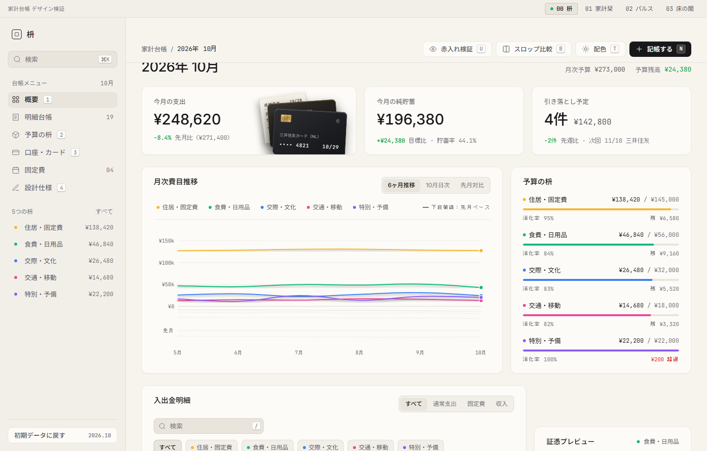 |
| **3. 口座・カード画面（`[3]`）** | **4. 予算の枡・インスペクタ画面** |
| 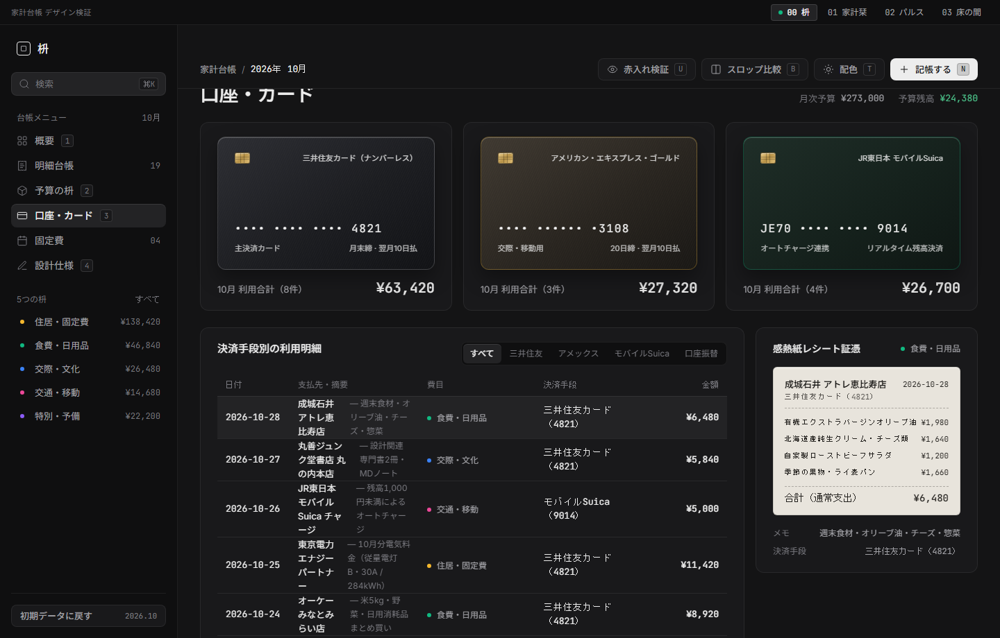 | 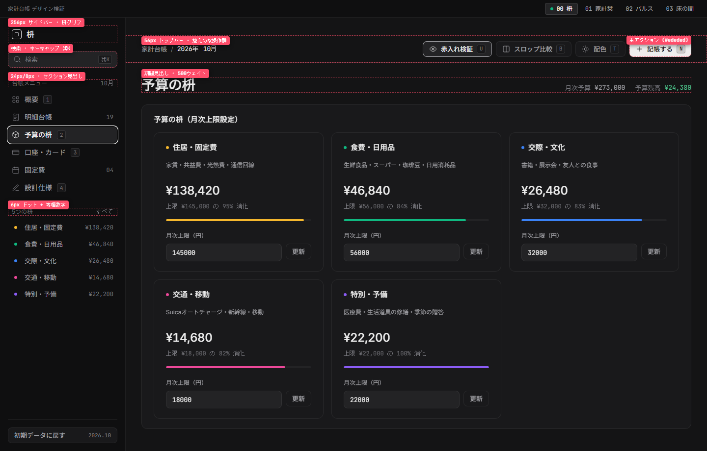 |

### `01` 家計栞 (Kakei Shiori) — Warm Botanical Archival Ledger

| 1. 月次手帖見開き（ライト — コットン紙） | 2. 月次手帖見開き（ダーク — 書斎の夜） |
| :---: | :---: |
|  | 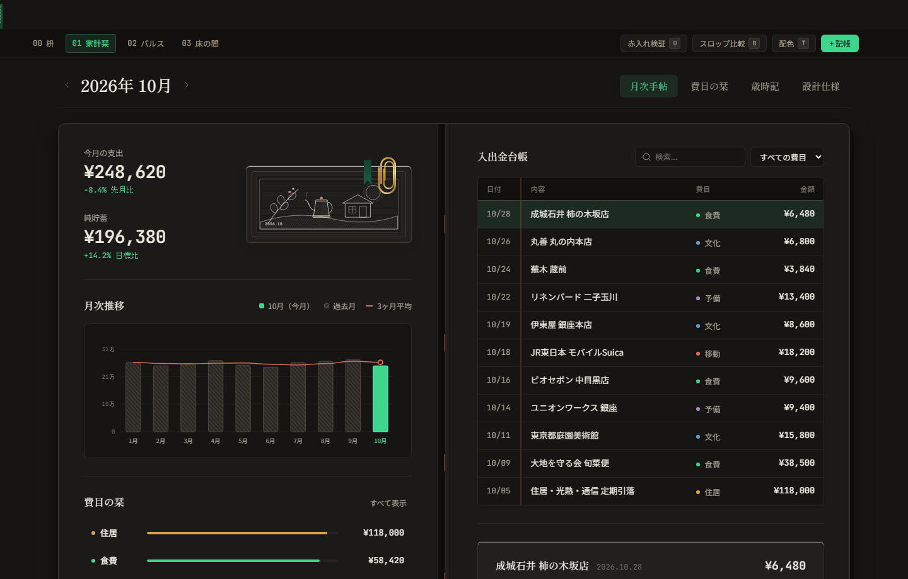 |
| **3. 費目の栞タブ（`費目の栞`）** | **4. 赤入れ検証モード（`[U]`）** |
| 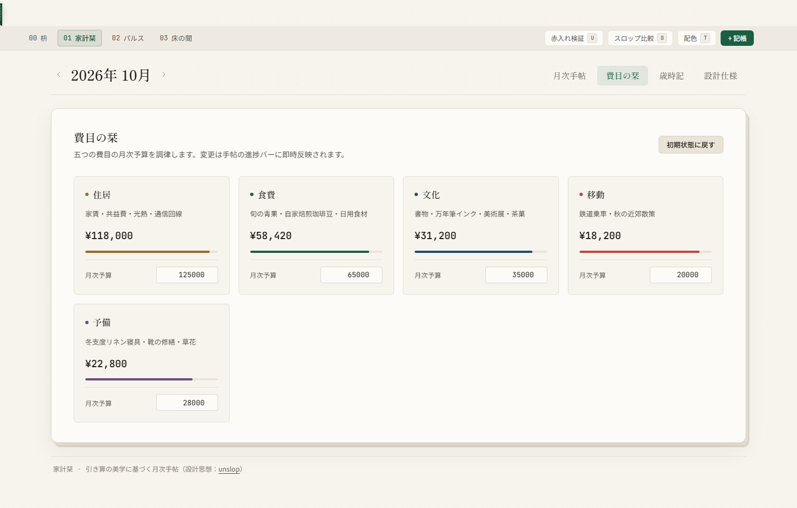 | 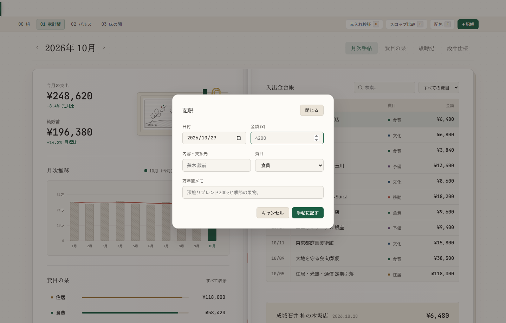 |

### `02` パルス (Pulse Telemetry) — Deep Ink Precision Cashflow OS

| 1. 概要コックピット（ダーク — Deep Ink） | 2. 概要コックピット（ライト — Clean Room） |
| :---: | :---: |
|  | 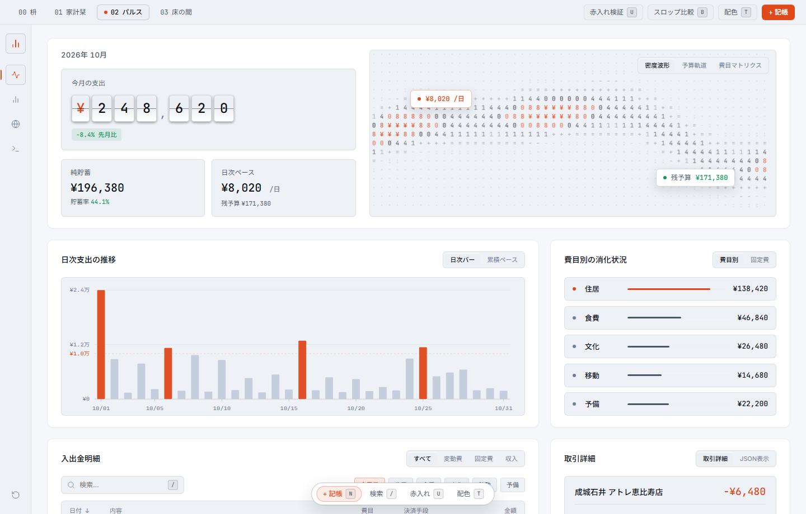 |
| **3. 日次推移とJSONインスペクタ** | **4. 赤入れ検証モード（`[U]`）** |
| 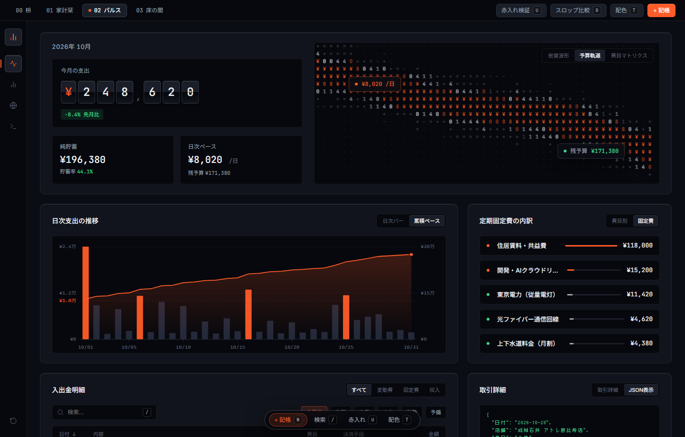 | 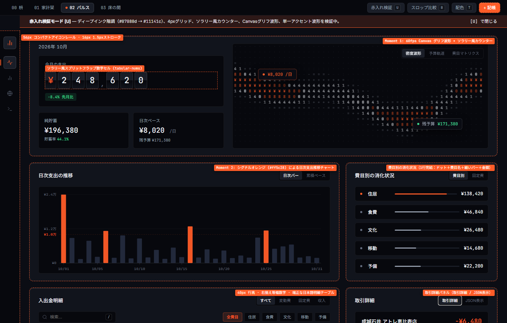 |

### `03` 床の間 (Tokonoma) — Editorial Brutalist Swiss Grid

| 1. 1pxスイスグリッド紙面（ライト — 漆喰の白） | 2. 1pxスイスグリッド紙面（ダーク — 墨石） |
| :---: | :---: |
|  | 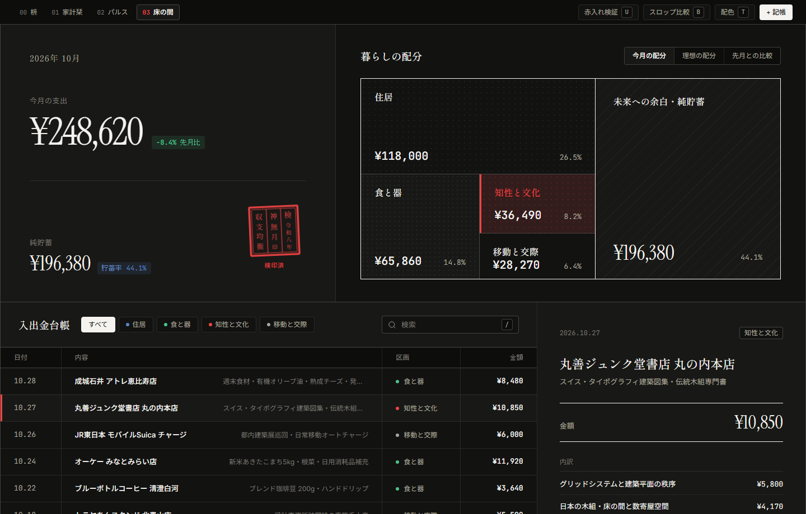 |
| **3. 費目フィルタと「暮らしの配分」図** | **4. 赤入れ検証モード（`[U]`）** |
| 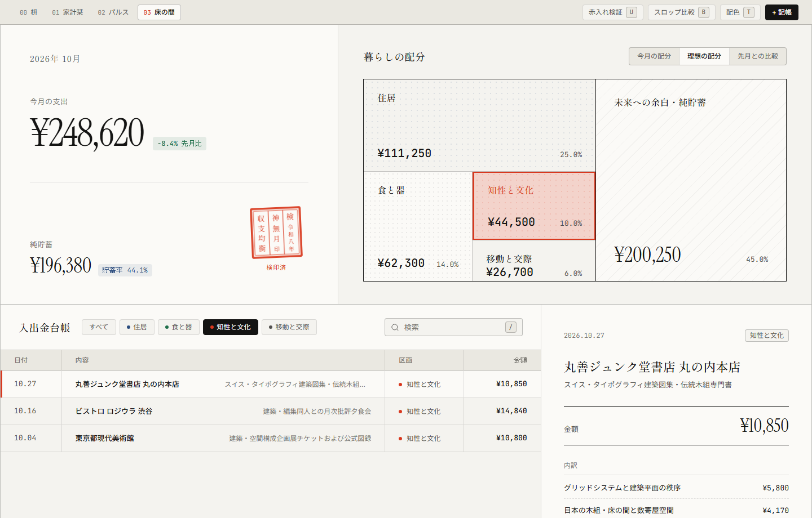 | 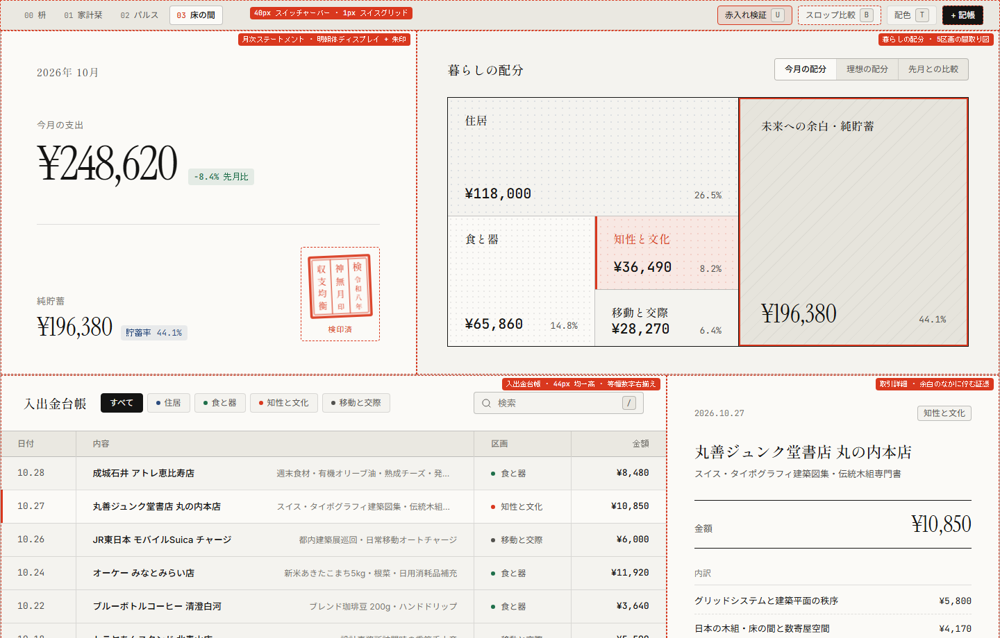 |

---

## 🔍 スキル検証：9つのPassと引き算のプロセス

[`heydamir/unslop`](https://github.com/heydamir/unslop) のスキル仕様を4つの異なるUI構造へ適用する過程で、**9つの赤入れ工程（9 Passes）**の有効性と、日本語UIにおける重要な知見（**日英二重表記や説明的サブラベルの撤去**）が明らかになりました。

### 9 Passes（9段階の赤入れ工程）の適用一覧

| Pass | 4コンセプト共通で徹底した規律 | 具体的な実装内容 |
| :--- | :--- | :--- |
| **1. Spacing** | `4px` グリッドの空間リズム（`4, 8, 12, 16, 20, 24, 28, 32, 40, 48px`） | ナビゲーション幅（Masuの `256px` サイドバー、Pulseの `56px` レール、Tokonomaの `1px` 境界グリッド）とパディングを厳密に統一 |
| **2. Color** | UIクロームは無彩色に徹し、色彩は意味論と「2つのMoments」のみに限定 | 紫グラデーションや発光ボーダーを全廃。黒鉛・コットン紙・深옥・漆喰の無彩色ベースに単一のアクセント色のみを配置 |
| **3. Icons** | 通常UIでの絵文字を完全禁止（0個）。`16px`・線幅 `1.5px` の単色SVGで統一 | すべてのアイコンを `currentColor` 継承のインラインSVGで実装（絵文字は `[B]` スロップ比較モード時のみ反面教師として出現） |
| **4. Copy** | 挨拶見出しや感嘆符を排し、すべての変化率に比較対象を明記 | `Welcome back! 👋` のような無意味な挨拶を廃し、`2026年 10月` の期間見出しと `-8.4% 先月比`・`目安 ¥8,000/日` の比較基準を併記 |
| **5. Type** | ウェイトは `400` と `500` のみ（極太 `700〜900` 禁止）。全数値に `tabular-nums` | `'Noto Sans JP'`, `'Shippori Mincho'`, `'JetBrains Mono'` を組み合わせ、金額・日付・比率の桁揃えを徹底 |
| **6. Layout** | 均等な3連カードの退屈な並びを排し、プロダクト固有の骨格を設計 | 台帳＋証憑インスペクタ（`00`）、見開き手帖（`01`）、計器デッキ（`02`）、`1px` 露出グリッド（`03`）の4様の空間構成を実現 |
| **7. Details** | 同心円の角丸設計（Nested Radius: `4px` → `8px` → `12px`）または完全な `0px` 直角 | 統計カード内の装飾的なミニスパークラインを撤去し、境界線は低コントラストの `1px` 実線に抑制 |
| **8. Visuals** | 汎用的な3Dブロブを排し、ドメイン固有の物理オブジェクトを描画 | 金属決済カード、ミシン目入り感熱紙、銅版画チケット、オシロスコープ波形、朱印スタンプをCSS/SVG/Canvasで緻密に構築 |
| **9. Motion** | 単一の静かなイージング曲線 `cubic-bezier(0.22, 1, 0.36, 1)` | 無限に脈動するアニメーションや `hover:scale` による拡大を排し、色・背景・境界線の静かな遷移のみに限定 |

### 検証で得られた最大の知見：「説明の引き算」と純日本語UIへの昇華

初期実装からブラッシュアップを重ねる中で、日本語のWebアプリケーションが陥りやすいもうひとつのスロップが浮かび上がりました。それは**「日英二重表記（`OVERVIEW · 概要` など）や、雰囲気作りのための説明的な英語サブラベル・図面コード（`FIG. 01 // ARCHIVAL SPEC` など）の過剰装飾」**です。

最終的な検証パスでは、これらの副次的なラベルを徹底的に削ぎ落としました。
- **100%純日本語のUI表記**: ナビゲーション、統計ラベル、レシートの明細項目、さらには `[U]` 赤入れ検証のツールチップに至るまで、日英の二重表記を廃止し、簡潔で自然な日本語のみに統一しました。
- **余白と「2つのMoments」に語らせる引き算**: とりわけ `03 床の間` や `01 家計栞` では、月次ステートメント区画の要素を「年月・今月の支出・予算の残り・象徴的な印（朱印や栞）」の4要素のみに絞り込みました。説明的な小文字ラベルを撤去して余白を広げることで、タイポグラフィの佇まいと2つのMomentsが際立つことを確認できます。

---

## 🚀 クイックスタートと操作方法

### 🌐 ライブデモ＆ドキュメント（GitHub Pages）

ブラウザからドキュメントサイトおよび4つの家計簿コンセプトを直接操作・比較できます。
- **ドキュメント＆検証ガイド（VitePress 日本語 / 英語）**: [https://sunwood-ai-labs.github.io/unslop-kakeibo-showcase/ja/](https://sunwood-ai-labs.github.io/unslop-kakeibo-showcase/ja/) ([English `/` ](https://sunwood-ai-labs.github.io/unslop-kakeibo-showcase/))
- **ライブデモ `00` 枡 (Masu — Tactile Graphite Ledger)**: [https://sunwood-ai-labs.github.io/unslop-kakeibo-showcase/demo/index.html](https://sunwood-ai-labs.github.io/unslop-kakeibo-showcase/demo/index.html)
- **ライブデモ `01` 家計栞 (Kakei Shiori — Botanical Archival Ledger)**: [https://sunwood-ai-labs.github.io/unslop-kakeibo-showcase/demo/concepts/shiori/index.html](https://sunwood-ai-labs.github.io/unslop-kakeibo-showcase/demo/concepts/shiori/index.html)
- **ライブデモ `02` パルス (Pulse Telemetry — Precision Cashflow OS)**: [https://sunwood-ai-labs.github.io/unslop-kakeibo-showcase/demo/concepts/pulse/index.html](https://sunwood-ai-labs.github.io/unslop-kakeibo-showcase/demo/concepts/pulse/index.html)
- **ライブデモ `03` 床の間 (Tokonoma — Editorial Swiss Grid)**: [https://sunwood-ai-labs.github.io/unslop-kakeibo-showcase/demo/concepts/tokonoma/index.html](https://sunwood-ai-labs.github.io/unslop-kakeibo-showcase/demo/concepts/tokonoma/index.html)

### 💻 ローカルでの起動方法

ビルドツールやフレームワークに依存しない純粋な HTML / CSS / JavaScript 構成のため、`index.html` を直接ブラウザで開くか、任意の静的ファイルサーバーで即座に動作します。

```bash
# リポジトリのクローン
git clone https://github.com/Sunwood-ai-labs/unslop-kakeibo-showcase.git
cd unslop-kakeibo-showcase

# ローカルサーバーで起動（任意のサーバーで可）
npx serve .
```

### ⌨️ キーボードショートカット一覧

すべてのコンセプトで共通のショートカットキーを備えており、`unslop` の設計原則をインタラクティブに検証できます。

| キー | 機能名 | 検証できる内容 |
| :---: | :--- | :--- |
| <kbd>U</kbd> | **赤入れ検証モード（`Unslop X-Ray`）** | 画面上の各要素に赤色のガイドラインと注釈を表示し、9 Passes のどの規律（`4px` グリッド、等幅数字、Moment 1/2 の境界など）が適用されているかを可視化します。 |
| <kbd>B</kbd> | **スロップ比較モード（`Compare Slop`）** | 現在の画面を典型的な「AIスロップ（ネオン紫グラデーション、絵文字の乱用、ピル型ボタン、煽りコピー）」へ即座に変形させ、`unslop` 適用の前後を比較します。 |
| <kbd>T</kbd> | **配色切替（`Theme Switch`）** | 各コンセプトの標準テーマと対極テーマ（黒鉛 ↔ 和紙、コットン紙 ↔ 書斎の夜、深옥 ↔ クリーンルーム、漆喰 ↔ 墨石）を切り替えます。 |
| <kbd>N</kbd> | **新規記帳モーダル（`Log Entry`）** | 新しい入出金明細を追加して `LocalStorage` に保存します。上段の統計値、Moment 2 のチャート、費目別残高、明細一覧がすべて連動して再計算されます。 |
| <kbd>/</kbd> または <kbd>⌘K</kbd> | **明細検索（`Search`）** | 検索ボックスにフォーカスし、店名・摘要・費目・決済手段でリアルタイムに明細を絞り込みます。 |
| <kbd>1</kbd> 〜 <kbd>4</kbd> | **ビュー・タブ切替** | 各コンセプト内のサブビュー（概要、明細台帳、予算の枡/費目、口座・カード/仕様など）を切り替えます。 |

---

## 📂 ディレクトリ構成

```text
unslop-kakeibo-showcase/
├── index.html                  # コンセプト 00: 枡 (Masu) — Tactile Graphite Ledger
├── styles.css                  # コンセプト 00 スタイルシート (4pxグリッド・黒鉛/和紙トークン)
├── app.js                      # コンセプト 00 ロジック・共通データ管理・検証モード制御
├── concepts/
│   ├── shiori/                 # コンセプト 01: 家計栞 (Kakei Shiori) — Botanical Archival Ledger
│   │   ├── index.html
│   │   ├── styles.css
│   │   └── app.js
│   ├── pulse/                  # コンセプト 02: パルス (Pulse Telemetry) — Precision Cashflow OS
│   │   ├── index.html
│   │   ├── styles.css
│   │   └── app.js
│   └── tokonoma/               # コンセプト 03: 床の間 (Tokonoma) — Editorial Swiss Grid
│       ├── index.html
│       ├── styles.css
│       └── app.js
├── assets/
│   ├── icon.svg                # 枡と4つのデザイン象限を表す幾何学SVGアイコン
│   └── header.svg              # READMEトップ用ワイドヒーローバナーSVG
├── screenshots/                # 全16枚の検証スクリーンショット (各コンセプト4枚×4)
│   ├── shot-00-masu-*.png
│   ├── shot-01-shiori-*.png
│   ├── shot-02-pulse-*.png
│   └── shot-03-tokonoma-*.png
├── docs/                       # 日英バイリンガル VitePress ドキュメント
├── README.md                   # 英語版 README
├── README.ja.md                # 日本語版 README
└── LICENSE                     # MIT License (コード) + CC BY 4.0 帰属表示 (unslop スキル)
```

---

## 🙏 クレジットとライセンス

### デザイン手法・スキル帰属（`heydamir/unslop`）

本プロジェクトの設計プロセス、5-Line Direction、および 9 Passes の検証フレームワークは、**Damir Sokolovsky ([@heydamir](https://x.com/heydamir))** 氏が制作した **[unslop](https://github.com/heydamir/unslop)**（[heydamir.design/unslop](https://heydamir.design/unslop)）に基づいています。同スキルは **[Creative Commons Attribution 4.0 International License (CC BY 4.0)](https://creativecommons.org/licenses/by/4.0/)** の下で提供されています。

### ソースコードのライセンス

本リポジトリ内のすべての HTML / CSS / JavaScript コード、SVGアセット、およびドキュメントは **[MIT License](./LICENSE)** の下で公開されています。
