<div align="center">
  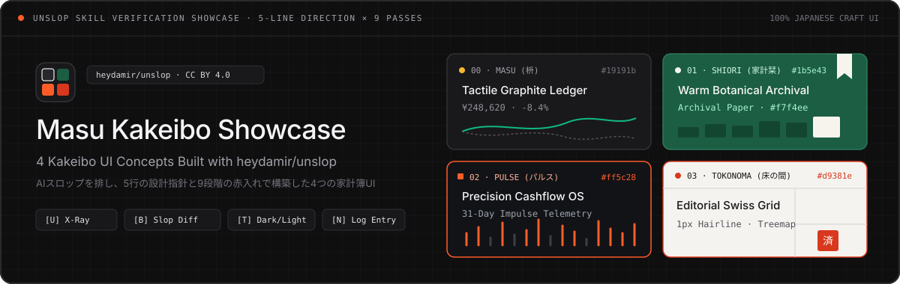

  # Unslop Kakeibo Showcase — 4 Household Ledger UI Concepts

  **A hands-on design verification showcase of the [`heydamir/unslop`](https://github.com/heydamir/unslop) UI skill — transforming identical household ledger data into 4 distinct, non-generic Japanese craft interfaces through a 5-Line Direction and 9 Redline Passes.**

  <p>
    <a href="https://Sunwood-ai-labs.github.io/unslop-kakeibo-showcase/"></a>
    <a href="https://github.com/Sunwood-ai-labs/unslop-kakeibo-showcase/actions/workflows/deploy-docs.yml"></a>
    
    <a href="./LICENSE"></a>
    <a href="https://github.com/heydamir/unslop"></a>
  </p>

  <p>
    <strong>English</strong> · <a href="./README.ja.md">日本語 (Japanese)</a>
  </p>

  <p>
    <strong>🚀 Launch Live Apps:</strong>
    <a href="https://sunwood-ai-labs.github.io/unslop-kakeibo-showcase/demo/index.html"><strong>00 枡 (Masu) ↗</strong></a> ·
    <a href="https://sunwood-ai-labs.github.io/unslop-kakeibo-showcase/demo/concepts/shiori/index.html"><strong>01 家計栞 (Shiori) ↗</strong></a> ·
    <a href="https://sunwood-ai-labs.github.io/unslop-kakeibo-showcase/demo/concepts/pulse/index.html"><strong>02 パルス (Pulse) ↗</strong></a> ·
    <a href="https://sunwood-ai-labs.github.io/unslop-kakeibo-showcase/demo/concepts/tokonoma/index.html"><strong>03 床の間 (Tokonoma) ↗</strong></a> ·
    <a href="https://sunwood-ai-labs.github.io/unslop-kakeibo-showcase/ja/"><strong>解説サイト (Docs) ↗</strong></a>
  </p>
</div>

---

## 🎯 Overview

**Unslop Kakeibo Showcase** is an interactive verification repository for **[`heydamir/unslop`](https://github.com/heydamir/unslop)** (by [Damir Sokolovsky](https://x.com/heydamir)), a UI design skill that eliminates generic AI-generated UI habits ("AI slop"—purple neon gradients, glowing borders, emoji-littered headers, redundant sparklines, and hype copy) and replaces them with intentional, domain-rooted product craft.

Using a single shared dataset of an October 2026 Japanese household ledger (*Kakeibo* / 家計簿: `¥248,620` monthly expenditure across 5 budget envelopes and 19 transactions), this project proves that **strict design constraints do not produce uniform templates**. By writing a distinct **5-Line Direction** (`Product`, `Character`, `World`, `2 Moments`, `Signature`) for each concept and enforcing the **9 Redline Passes**, the exact same functional application takes on four radically different, authentic visual identities:

1. **`00` 枡 (Masu)** — *Tactile Graphite Ledger* (`#19191b`)
2. **`01` 家計栞 (Kakei Shiori)** — *Warm Botanical Archival Ledger* (`#1b5e43` / `#f7f4ee`)
3. **`02` パルス (Pulse Telemetry)** — *Deep Ink Precision Cashflow OS* (`#ff5c28` / `#0a0b0d`)
4. **`03` 床の間 (Tokonoma)** — *Editorial Brutalist Swiss Grid* (`#d9381e` / `#f4f3ef`)

Every concept is implemented in zero-dependency HTML, CSS, and Vanilla JavaScript, featuring live **Unslop X-Ray Redlines (`[U]`)**, **AI Slop Before/After Diffing (`[B]`)**, **Dark/Light Theme Polarity (`[T]`)**, and persistent **Transaction Logging (`[N]`)**.

---

## 🎨 Four Distinct Concepts

All four interfaces share the same underlying ledger state (`LocalStorage` synchronized) and a top **Concept Switcher Bar** for instant comparison.

| ID & Concept | Entry Path | Character | World & Surface Palette | Moment 1 (Primary Visual Anchor) | Moment 2 (Data / Analytical Anchor) | Signature Detail |
| :--- | :--- | :--- | :--- | :--- | :--- | :--- |
| **`00` 枡 (Masu)**<br>*Tactile Graphite Ledger* | [`index.html`](./index.html) | `calm, exact, tactile` | Graphite pencil lead, fresh thermal paper receipt, brushed metal payment cards, wooden *Masu* box joints (`#141415` / `#19191b`) | **Tactile Cards & Thermal Receipt**: Overlapping brushed-metal EMV cards (`•••• 4821`) with a serrated thermal receipt peeking from behind | **Mirrored Envelope Flow Chart**: 5 smooth cubic Bézier splines color-locked to `6px` category dots, mirrored below the zero baseline against September | Standalone keycap badges (`⌘K`, `N`, `1`–`4`, `U`, `B`, `T`) and `6px` semantic envelope dots |
| **`01` 家計栞 (Kakei Shiori)**<br>*Warm Botanical Archival Ledger* | [`concepts/shiori/index.html`](./concepts/shiori/index.html) | `warm, literary, unhurried` | Cotton archival paper, fountain-pen botanical green ink, brass paperclips, stitched bookbinding (`#f7f4ee` / `#1b5e43`) | **Brass-Clipped Botanical Receipt**: Engraved botanical voucher specimen pinned to the right margin of the ledger spread | **Single-Lit Seasonal Bar Chart**: 6-month expenditure bars where May–September stay muted warm stone and only October is lit in deep botanical ink (`#1b5e43`) | Hanging bookmark ribbon (`栞`) at the top-right edge that toggles X-Ray mode (`[U]`) on click |
| **`02` パルス (Pulse Telemetry)**<br>*Deep Ink Precision Cashflow OS* | [`concepts/pulse/index.html`](./concepts/pulse/index.html) | `technical, high-precision, atmospheric` | Deep ink oscilloscope deck, tabular monospace readouts, single signal-orange telemetry channel (`#0a0b0d` / `#ff5c28`) | **Live Canvas 2D Oscilloscope & Split-Flap Readout**: Real-time cashflow waveform paired with mechanical split-flap digits | **31-Day Daily Impulse Stem Chart**: High-density daily expenditure impulse stems highlighting peak spend days in signal orange (`#ff5c28`) against a `¥8,000/day` target line | `56px` compact left icon rail with instant keyboard-indexed view switching and JSON state inspection |
| **`03` 床の間 (Tokonoma)**<br>*Editorial Brutalist Swiss Grid* | [`concepts/tokonoma/index.html`](./concepts/tokonoma/index.html) | `architectural, serene, structural` | Alabaster plaster (`#f4f3ef`), Sumi ink (`#181818`), exposed `1px` architectural hairlines, generous whitespace, vermilion seal (`#d9381e`) | **Typographic Statement & Vermilion Hanko Seal**: Oversized serif expenditure figure (`¥248,620`) paired with a single rotated vermilion stamp (`精算済`) | **Architectural Floorplan Treemap**: 5-room spatial allocation diagram (`暮らしの配分`) dividing monthly spending by proportional area and `1px` structural rules | Exposed `1px` continuous grid hairlines with zero rounded cards, zero drop shadows, and four-element editorial restraint |

---

## 📸 Visual Gallery (16 Screenshots)

Each concept is captured across four verification states: primary theme overview, alternate theme polarity, specialized domain view, and interactive inspection (`[U]` X-Ray Redlines or `[N]` Entry Modal).

### `00` 枡 (Masu) — Tactile Graphite Ledger

| 1. Overview (Dark — Quiet Graphite) | 2. Overview (Light — Warm Paper) |
| :---: | :---: |
|  | 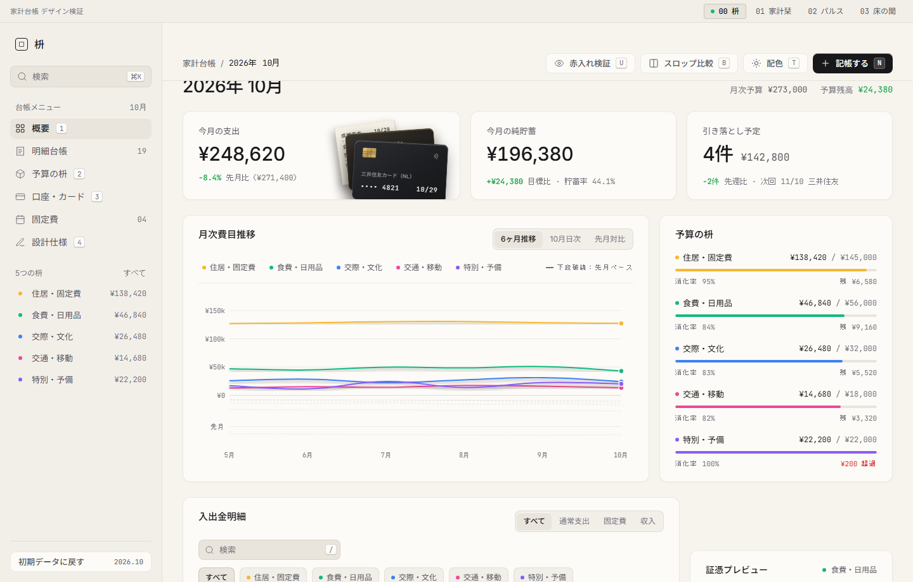 |
| **3. Cards & Accounts View (`[3]`)** | **4. Envelopes & Inspection View** |
| 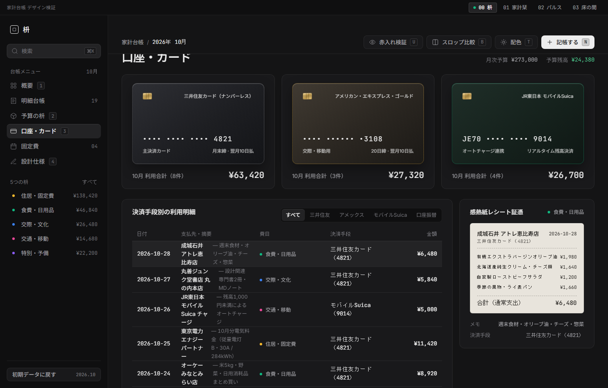 | 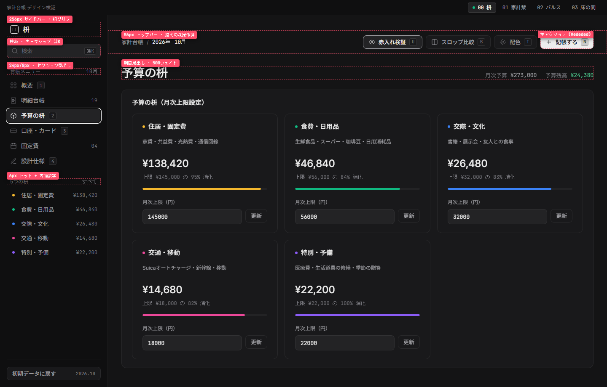 |

### `01` 家計栞 (Kakei Shiori) — Warm Botanical Archival Ledger

| 1. Monthly Spread (Light — Archival Cotton) | 2. Monthly Spread (Dark — Nocturnal Study) |
| :---: | :---: |
|  | 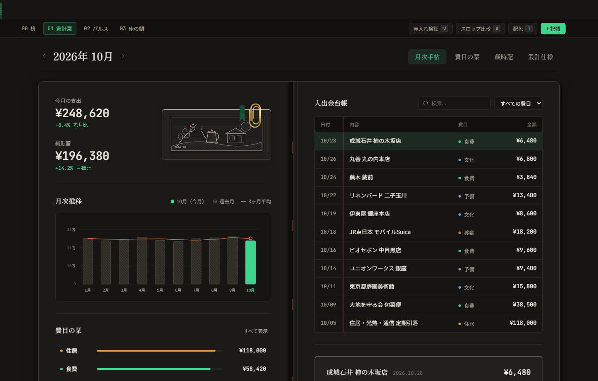 |
| **3. Envelopes Tab (`費目の栞`)** | **4. Unslop X-Ray Redline Mode (`[U]`)** |
| 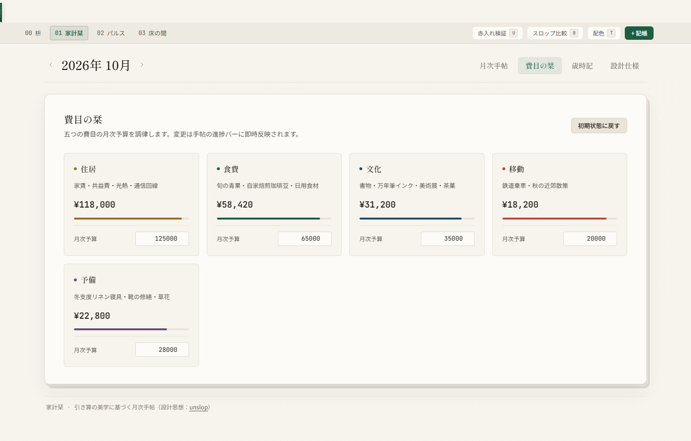 | 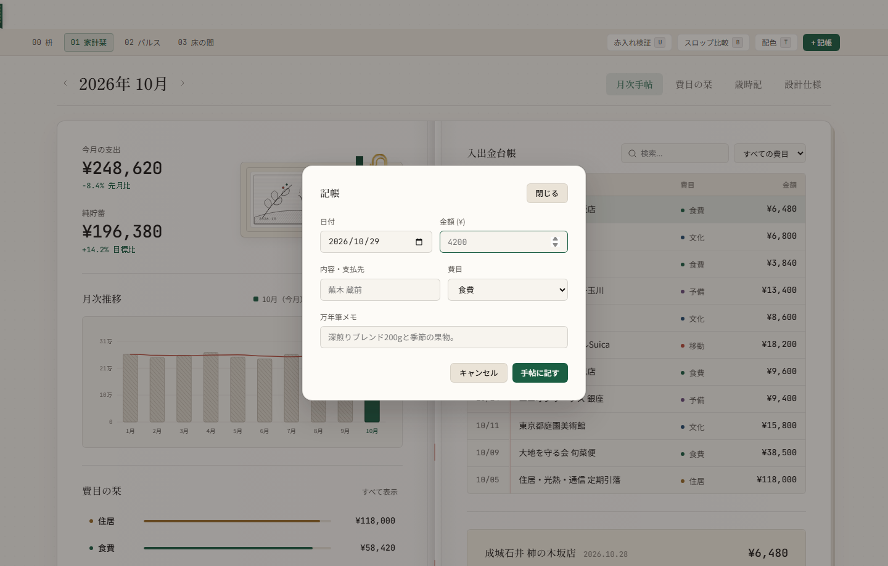 |

### `02` パルス (Pulse Telemetry) — Deep Ink Precision Cashflow OS

| 1. Telemetry Cockpit (Dark — Deep Ink) | 2. Telemetry Cockpit (Light — Clean Room) |
| :---: | :---: |
|  | 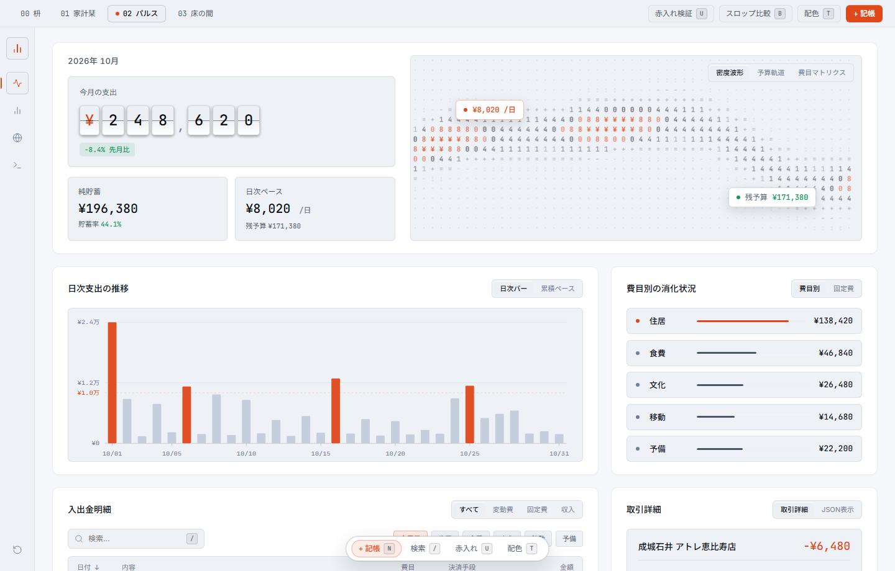 |
| **3. Daily Trajectory & JSON Inspector** | **4. Unslop X-Ray Redline Mode (`[U]`)** |
| 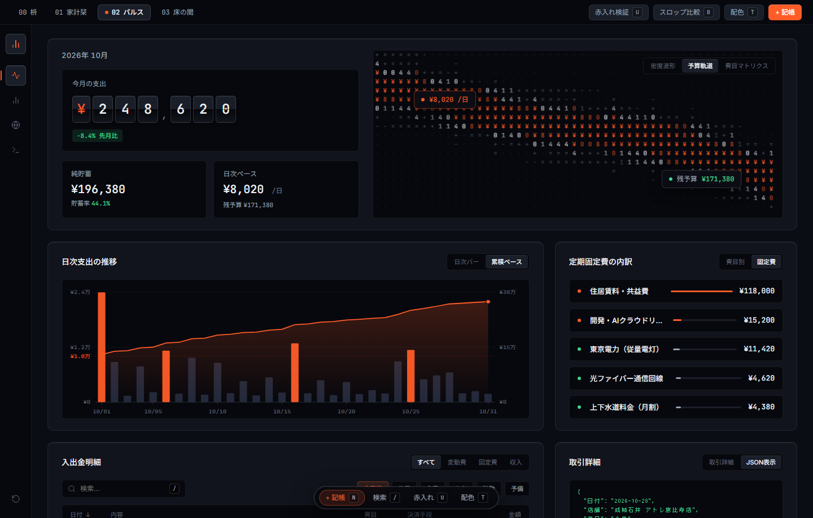 | 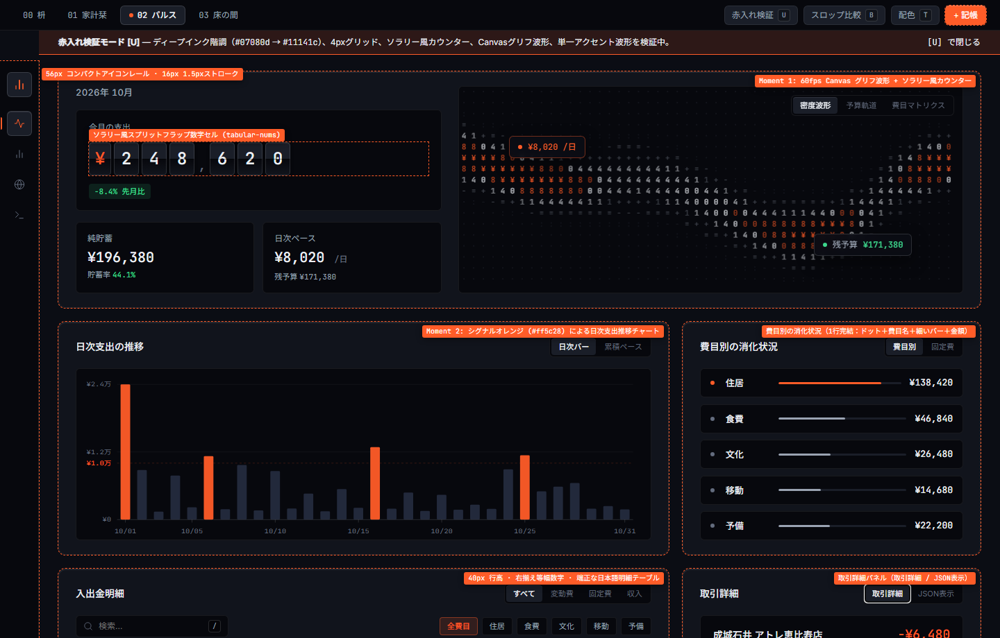 |

### `03` 床の間 (Tokonoma) — Editorial Brutalist Swiss Grid

| 1. Swiss Grid Sheet (Light — Alabaster Plaster) | 2. Swiss Grid Sheet (Dark — Sumi Stone) |
| :---: | :---: |
|  | 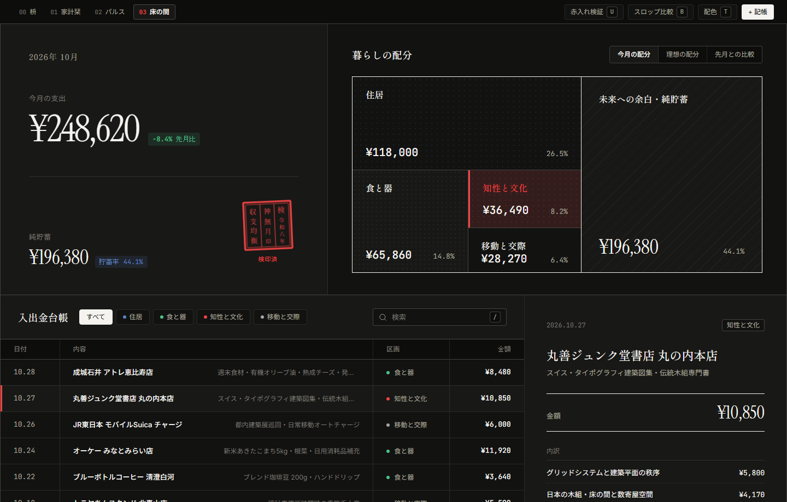 |
| **3. Category Filter & Spatial Treemap** | **4. Unslop X-Ray Redline Mode (`[U]`)** |
| 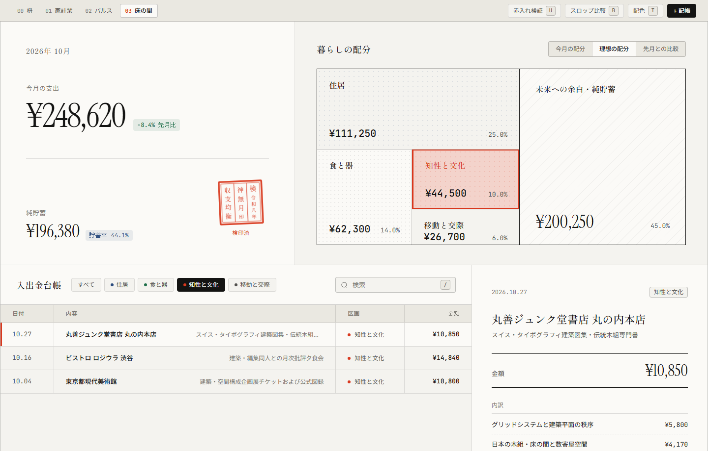 | 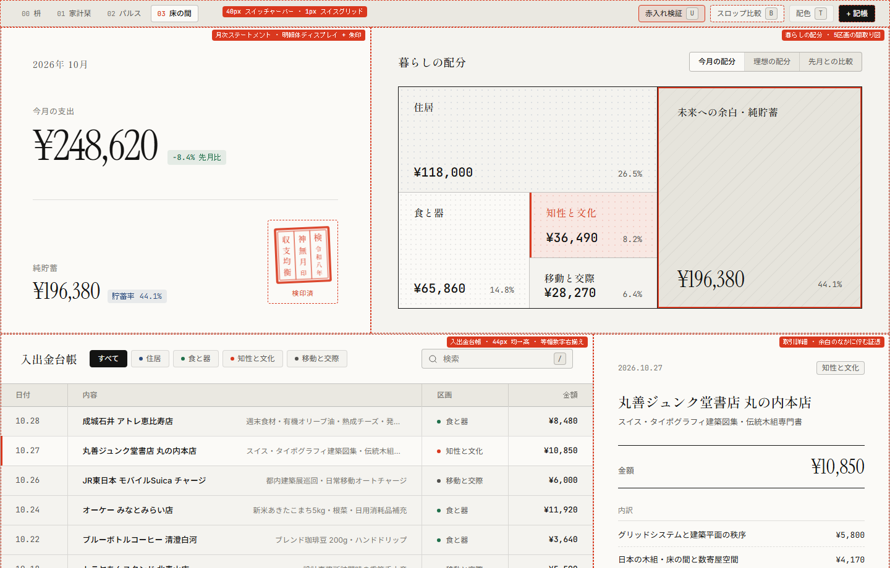 |

---

## 🔍 Skill Verification: 9 Passes & Decluttering

Applying [`heydamir/unslop`](https://github.com/heydamir/unslop) across four distinct UI architectures validated both the **9 Redline Passes** and a crucial localization lesson for Japanese interfaces: **radical decluttering**.

### How the 9 Passes Were Enforced

| Pass | Rule Enforced Across All 4 Concepts | Concrete Implementation |
| :--- | :--- | :--- |
| **1. Spacing** | Strict `4px` spatial rhythm (`4, 8, 12, 16, 20, 24, 28, 32, 40, 48px`) | Fixed navigation dimensions (`256px` sidebar in Masu, `56px` rail in Pulse, `1px` exposed cell hairlines in Tokonoma) with zero arbitrary pixel gaps |
| **2. Color** | Neutral chrome; color reserved strictly for semantics and the 2 Moments | Eliminated purple/cyan AI gradients; restrained surfaces to graphite, cotton paper, deep ink, or plaster with single intentional accents (`#1b5e43`, `#ff5c28`, `#d9381e`) |
| **3. Icons** | Zero emojis in production UI; monochrome `16px` stroke icons (`1.5px`) | All navigation and utility icons use inline SVG inheriting `currentColor`; emojis appear only when `[B]` Slop Comparison Mode is toggled on |
| **4. Copy** | Context-first headings; every delta states its benchmark | Replaced generic greetings (`Welcome back! 👋`) with period headings (`2026年 10月`) and explicit comparisons (`-8.4% 先月比`, `目安 ¥8,000/日`) |
| **5. Type** | Weights `400` and `500` only; `tabular-nums` on every figure | Paired `'Inter'` / `'Plus Jakarta Sans'` / `'Newsreader'` / `'Instrument Serif'` with `'Noto Sans JP'`, `'Shippori Mincho'`, and `'JetBrains Mono'` |
| **6. Layout** | Structural hierarchy without uniform 3-equal-card boredom | Each concept uses a distinct spatial skeleton: asymmetric ledger + inspector (`00`), bound two-page folio (`01`), telemetry cockpit (`02`), and 2×2 Swiss sheet (`03`) |
| **7. Details** | Concentric nested radii (`4px` keycaps → `8px` controls → `12px` cards) or pure `0px` corners | Removed mini-sparklines from stat cards; kept borders to `1px` solid low-opacity hairlines |
| **8. Visuals** | Domain-specific artifacts over abstract 3D blobs | Built CSS/SVG/Canvas tactile credit cards, serrated receipts, botanical engravings, impulse waveforms, and Hanko stamps |
| **9. Motion** | Single quiet easing curve `cubic-bezier(0.22, 1, 0.36, 1)` | Zero infinite pulse loops or `hover:scale` bounce effects; transitions apply only to color, border, and surface state |

### Key Verification Insight: Eliminating Bilingual Clutter & Letting the 2 Moments Speak

During iterative verification, we discovered a subtle form of "craft slop" common in Japanese web apps: **bilingual label duplication and decorative metadata** (e.g., writing `OVERVIEW · 概要`, `ENVELOPES · 予算の枡`, or adding fake architectural blueprint codes like `FIG. 01 // ARCHIVAL SPEC` under every heading).

In our final verification pass, we stripped away all secondary explanatory sublabels and English-Japanese dual labels:
- **100% Pure Japanese UI**: Every navigation item, stat label, receipt field, and X-Ray annotation speaks in clear, natural Japanese (`2026年 10月`, `今月の支出`, `予算の残り`, `暮らしの配分`, `赤入れ検証`).
- **Four-Element Restraint**: In concepts like `03 床の間 (Tokonoma)` and `01 家計栞 (Kakei Shiori)`, reducing the primary statement cell to just four essential elements—period heading, main expenditure figure, budget balance, and the signature visual mark—allowed the surrounding whitespace and the **2 Moments** to carry the entire emotional weight of the interface.

---

## 🚀 Quick Start & Interactive Features

### 🌐 Live Demo & Documentation (GitHub Pages)

Explore the documentation portal and all four interactive Kakeibo concepts directly in your browser:
- **Documentation & Verification Guide (VitePress EN / JA)**: [https://sunwood-ai-labs.github.io/unslop-kakeibo-showcase/](https://sunwood-ai-labs.github.io/unslop-kakeibo-showcase/) ([日本語版 `/ja/`](https://sunwood-ai-labs.github.io/unslop-kakeibo-showcase/ja/))
- **Live Demo `00` 枡 (Masu — Tactile Graphite Ledger)**: [https://sunwood-ai-labs.github.io/unslop-kakeibo-showcase/demo/index.html](https://sunwood-ai-labs.github.io/unslop-kakeibo-showcase/demo/index.html)
- **Live Demo `01` 家計栞 (Kakei Shiori — Botanical Archival Ledger)**: [https://sunwood-ai-labs.github.io/unslop-kakeibo-showcase/demo/concepts/shiori/index.html](https://sunwood-ai-labs.github.io/unslop-kakeibo-showcase/demo/concepts/shiori/index.html)
- **Live Demo `02` パルス (Pulse Telemetry — Precision Cashflow OS)**: [https://sunwood-ai-labs.github.io/unslop-kakeibo-showcase/demo/concepts/pulse/index.html](https://sunwood-ai-labs.github.io/unslop-kakeibo-showcase/demo/concepts/pulse/index.html)
- **Live Demo `03` 床の間 (Tokonoma — Editorial Swiss Grid)**: [https://sunwood-ai-labs.github.io/unslop-kakeibo-showcase/demo/concepts/tokonoma/index.html](https://sunwood-ai-labs.github.io/unslop-kakeibo-showcase/demo/concepts/tokonoma/index.html)

### 💻 Run Locally

Because the application is built with zero-dependency vanilla HTML, CSS, and JavaScript, you can open `index.html` directly or serve the directory with any static HTTP server:

```bash
# Clone the repository
git clone https://github.com/Sunwood-ai-labs/unslop-kakeibo-showcase.git
cd unslop-kakeibo-showcase

# Serve the 4 concepts locally (pick any static server)
npx serve .
```

### ⌨️ Interactive Keyboard Shortcuts

Every concept supports instant keyboard inspection so you can test the `unslop` methodology live:

| Key | Action | What It Demonstrates |
| :---: | :--- | :--- |
| <kbd>U</kbd> | **Unslop X-Ray Redlines (`赤入れ検証`)** | Overlays red architectural callouts explaining which of the 9 Passes governs each component (`4px` spacing, `tabular-nums`, Moment 1/2 boundaries). |
| <kbd>B</kbd> | **Compare AI Slop (`スロップ比較`)** | Morphs the live interface into a typical "AI Slop" dashboard (neon purple gradients, emoji spam, pill buttons, hype copy) to contrast with the unslopped design. |
| <kbd>T</kbd> | **Theme Polarity (`配色切替`)** | Switches between each concept's primary surface and its counterpart (Dark Graphite ↔ Warm Paper, Archival Cotton ↔ Nocturnal Study, Deep Ink ↔ Clean Room). |
| <kbd>N</kbd> | **Log Transaction (`新規記帳`)** | Opens the modal to record a new expense or income item. Updates `LocalStorage` and dynamically recalculates all charts, envelopes, and tables across concepts. |
| <kbd>/</kbd> or <kbd>⌘K</kbd> | **Search Ledger (`明細検索`)** | Focuses the real-time transaction filter to search by merchant, category, or payment method. |
| <kbd>1</kbd> – <kbd>4</kbd> | **Switch Views / Tabs** | Navigates between sub-views within the active concept (Overview, Envelopes, Cards/Accounts, Spec/Stream). |

---

## 📂 Repository Structure

```text
unslop-kakeibo-showcase/
├── index.html                  # Concept 00: 枡 (Masu) — Tactile Graphite Ledger
├── styles.css                  # Concept 00 stylesheet (4px grid, graphite/paper tokens)
├── app.js                      # Concept 00 logic, shared ledger state & interactive modes
├── concepts/
│   ├── shiori/                 # Concept 01: 家計栞 (Kakei Shiori) — Botanical Archival Ledger
│   │   ├── index.html
│   │   ├── styles.css
│   │   └── app.js
│   ├── pulse/                  # Concept 02: パルス (Pulse Telemetry) — Precision Cashflow OS
│   │   ├── index.html
│   │   ├── styles.css
│   │   └── app.js
│   └── tokonoma/               # Concept 03: 床の間 (Tokonoma) — Editorial Swiss Grid
│       ├── index.html
│       ├── styles.css
│       └── app.js
├── assets/
│   ├── icon.svg                # Geometric Masu 4-quadrant emblem
│   └── header.svg              # Wide README hero banner
├── screenshots/                # 16 verification screenshots (4 per concept)
│   ├── shot-00-masu-*.png
│   ├── shot-01-shiori-*.png
│   ├── shot-02-pulse-*.png
│   └── shot-03-tokonoma-*.png
├── docs/                       # Bilingual VitePress documentation (EN / JA)
├── README.md                   # English documentation
├── README.ja.md                # Japanese documentation (日本語)
└── LICENSE                     # MIT License (code) + CC BY 4.0 attribution (unslop skill)
```

---

## 🙏 Credits & License

### Design Methodology Attribution (`heydamir/unslop`)

This project's design workflow, 5-Line Direction structure, and 9 Redline Passes are based on **[unslop](https://github.com/heydamir/unslop)** ([heydamir.design/unslop](https://heydamir.design/unslop)) created by **Damir Sokolovsky ([@heydamir](https://x.com/heydamir))**, licensed under the **[Creative Commons Attribution 4.0 International License (CC BY 4.0)](https://creativecommons.org/licenses/by/4.0/)**.

### Source Code License

All HTML, CSS, JavaScript, SVG assets, and documentation in this repository are released under the **[MIT License](./LICENSE)**.
