# 4 Design Concepts & Visual Gallery

Each of the four applications is a standalone, zero-dependency HTML/CSS/JS implementation that can be launched directly in your browser. They share the same Concept Switcher Bar at the top of the viewport so you can jump between worlds with a single click.

---

## `00` Masu (枡) — Quiet Graphite Ledger

- **Live Demo**: **[Open 00 Masu in Browser ↗](/unslop-kakeibo-showcase/demo/index.html){target="_blank"}**
- **Character**: `calm, exact, tactile`
- **World**: Graphite writing instruments, freshly printed thermal paper receipts, brushed metal payment cards with brass EMV contacts, and the crisp wooden compartments of a traditional Japanese *masu* measuring box.
- **Surface Palette**:
  - Dark Mode (Default): Quiet Graphite (`#0f0f10` canvas, `#141415` sidebar, `#19191b` elevated card, `#232325` hairline border)
  - Light Mode: Warm Ledger Paper (`#f2efe9` canvas, `#f7f4ee` sidebar, `#fdfbf7` card)
- **Moment 1 — Tactile Cards & Thermal Receipt**: Positioned inside the top-right primary expenditure card, two overlapping physical payment cards (brushed graphite metal + EMV gold/silver chip + monospace engraving `•••• 4821`) sit in front of a serrated thermal paper receipt.
- **Moment 2 — 5-Envelope Mirrored Spline Chart**: Five smooth cubic Bézier curves color-linked to the `6px` category dots (`#f5b82e`, `#10b981`, `#3b82f6`, `#ec4899`, `#8b5cf6`) above the zero baseline, with the previous month's spending trajectory mirrored softly below.
- **Signature**: Recessed `4px`-radius keycap badges (`⌘K`, `N`, `1`–`4`, `U`, `B`, `T`) and `6px` status dots across sidebar and ledger rows.

### Screenshots (00 Masu)

#### 1. Overview — Quiet Graphite Dark Mode (`shot-00-masu-1-overview-dark.png`)

#### 2. Overview — Warm Paper Light Mode (`shot-00-masu-2-overview-light.png`)
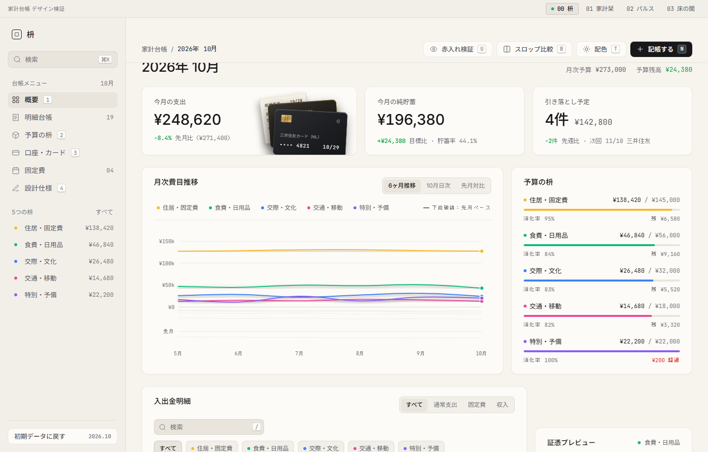

#### 3. Cards & Accounts Sub-View (`shot-00-masu-3-cards-view.png`)
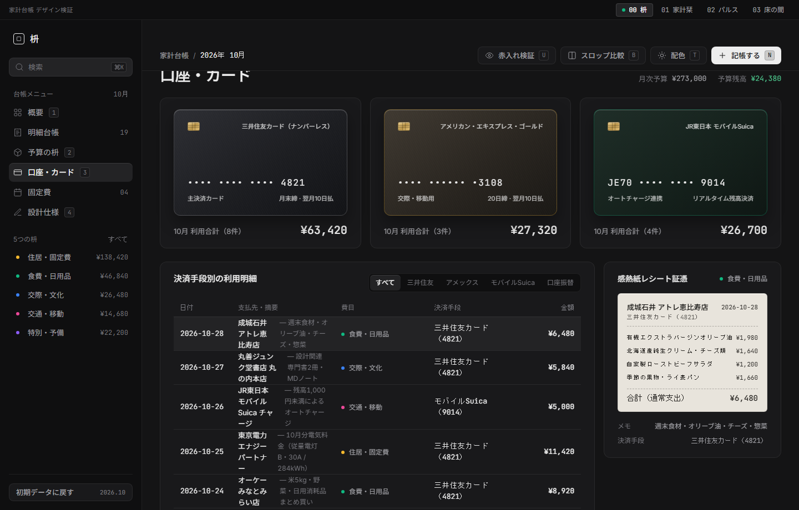

#### 4. Unslop X-Ray Redline Inspection (`shot-00-masu-4-envelopes-or-modal.png`)
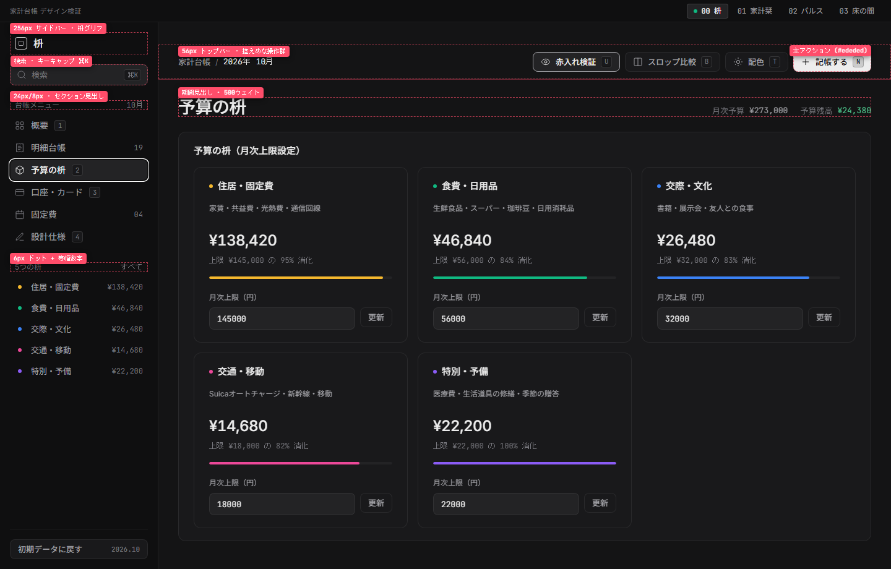

---

## `01` Kakei Shiori (家計栞) — Archival Paper Folio

- **Live Demo**: **[Open 01 Kakei Shiori in Browser ↗](/unslop-kakeibo-showcase/demo/concepts/shiori/index.html){target="_blank"}**
- **Character**: `warm, literary, unhurried`
- **World**: Fountain-pen ink on archival cotton paper, open two-page book spreads, brass paperclips, copperplate botanical specimen vouchers, and a crimson woven bookmark ribbon.
- **Surface Palette**:
  - Light Mode (Default): Archival Cotton (`#f7f4ee` spread background, `#fdfbf7` folio sheet, `#1f1e1b` deep sepia-black ink)
  - Dark Mode: Midnight Study (`#141311` desk, `#1c1a17` folio sheet, `#ece7df` parchment ink)
- **Moment 1 — Brass-Clipped Botanical Voucher**: On the right folio column, the selected transaction's receipt is rendered as a letterpress archival voucher held to the page by a drawn brass paperclip and framed with a copperplate botanical vignette.
- **Moment 2 — Single-Highlighted Seasonal Bar Chart**: A 6-month expenditure bar chart (`5月`–`10月`) where historical months remain muted archival stone while only the active month (`10月`) is filled in deep fountain-pen viridian green (`#1e4d3b`).
- **Signature**: A hanging crimson cloth bookmark ribbon (`栞`) anchored at the top-right edge that toggles the redline X-Ray inspection mode on click.

### Screenshots (01 Kakei Shiori)

#### 1. Two-Page Folio Spread — Archival Light Mode (`shot-01-shiori-1-spread-light.png`)

#### 2. Two-Page Folio Spread — Study Dark Mode (`shot-01-shiori-2-spread-dark.png`)
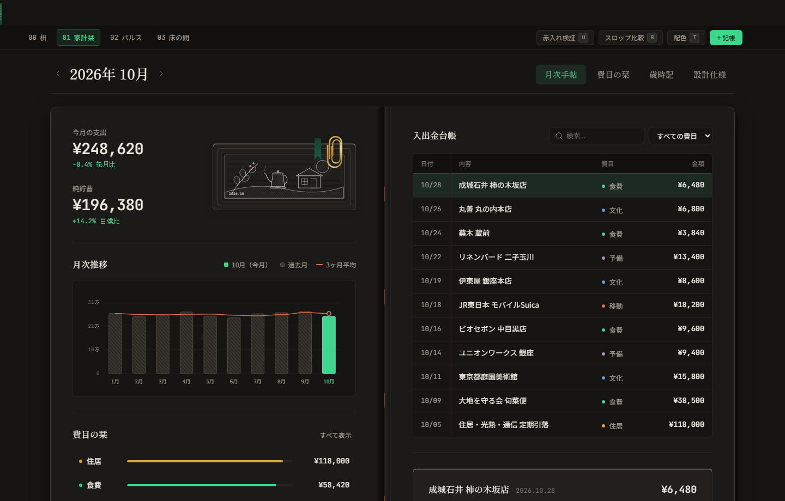

#### 3. Budget Envelopes Folio Tab (`shot-01-shiori-3-envelopes-tab.png`)
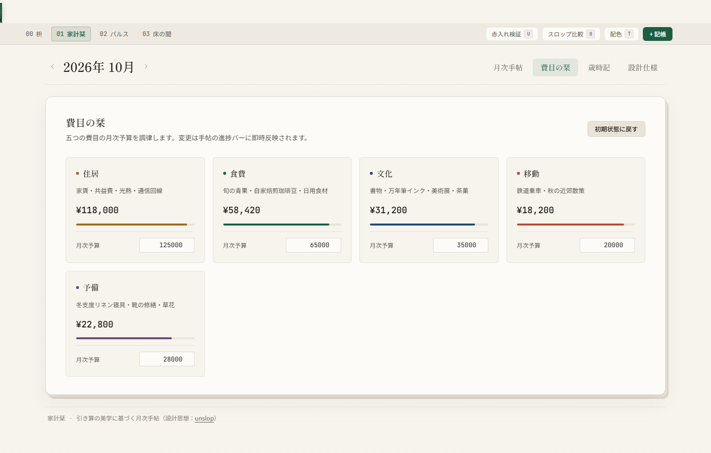

#### 4. Unslop X-Ray Redline Inspection (`shot-01-shiori-4-xray-or-modal.png`)
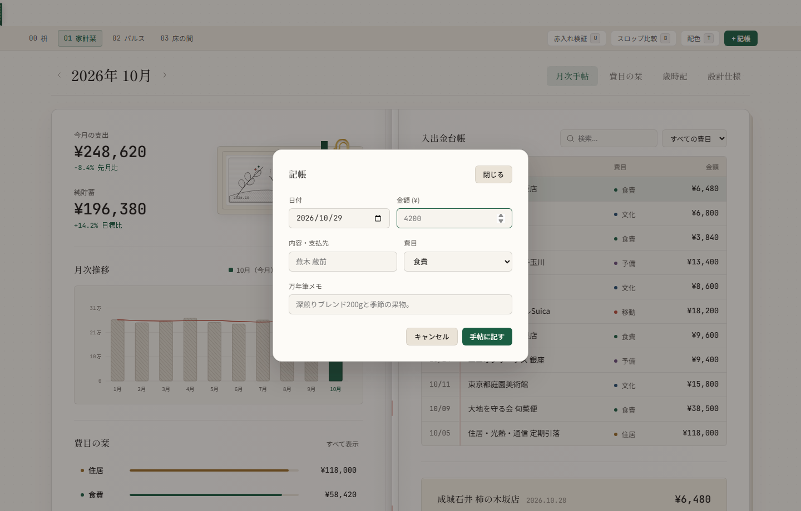

---

## `02` Pulse (パルス) — High-Precision Telemetry

- **Live Demo**: **[Open 02 Pulse in Browser ↗](/unslop-kakeibo-showcase/demo/concepts/pulse/index.html){target="_blank"}**
- **Character**: `technical, high-precision, atmospheric`
- **World**: Studio audio spectrum analyzers, high-precision oscilloscope displays, mechanical split-flap departure boards, and dark anodized aluminum instrument panels.
- **Surface Palette**:
  - Dark Mode (Default): Deep Ink (`#0a0b0d` chassis, `#101216` instrument bay, `#ff5722` single signal orange accent)
  - Light Mode: Clean Lab Ceramic (`#f3f4f6` chassis, `#ffffff` module surface)
- **Moment 1 — Live Oscilloscope Glyph & Split-Flap Counter**: A real-time Canvas 2D sine-harmonics oscilloscope waveform paired with a mechanical split-flap numeral display for the monthly expenditure readout.
- **Moment 2 — 31-Day Daily Impulse Horizon**: Every day of October is plotted as a vertical impulse bar in signal orange (`#ff5722`) against a quiet cumulative pacing curve, making zero-spend days (`無支出日: 9日`) and spending spikes immediately legible.
- **Signature**: A compact `56px` left icon rail (`16px` stroke icons with keyboard tooltips `1`–`4`) and monospace instrument crosshairs.

### Screenshots (02 Pulse)

#### 1. Telemetry Cockpit — Deep Ink Dark Mode (`shot-02-pulse-1-overview-dark.png`)

#### 2. Telemetry Cockpit — Lab Ceramic Light Mode (`shot-02-pulse-2-overview-light.png`)
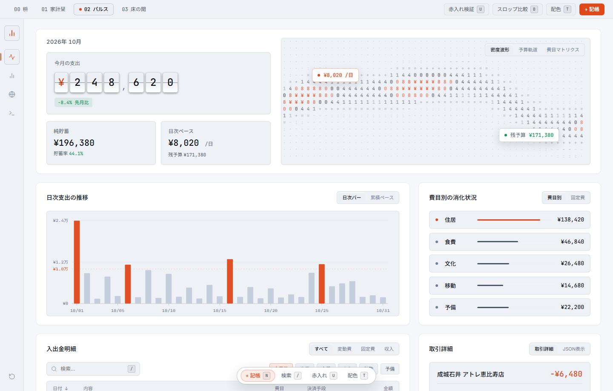

#### 3. Daily Burn Trajectory & Raw Data View (`shot-02-pulse-3-trajectory-json.png`)
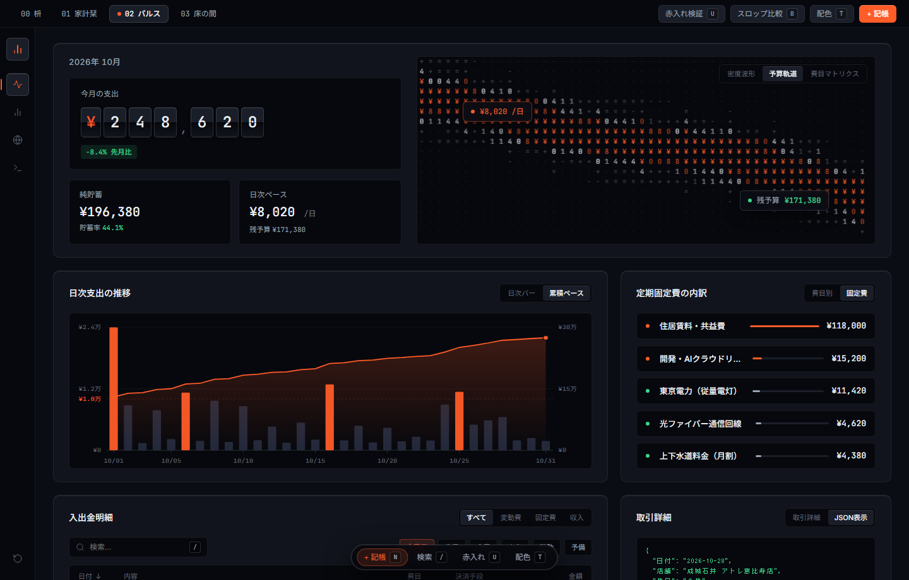

#### 4. Unslop X-Ray Redline Inspection (`shot-02-pulse-4-xray.png`)
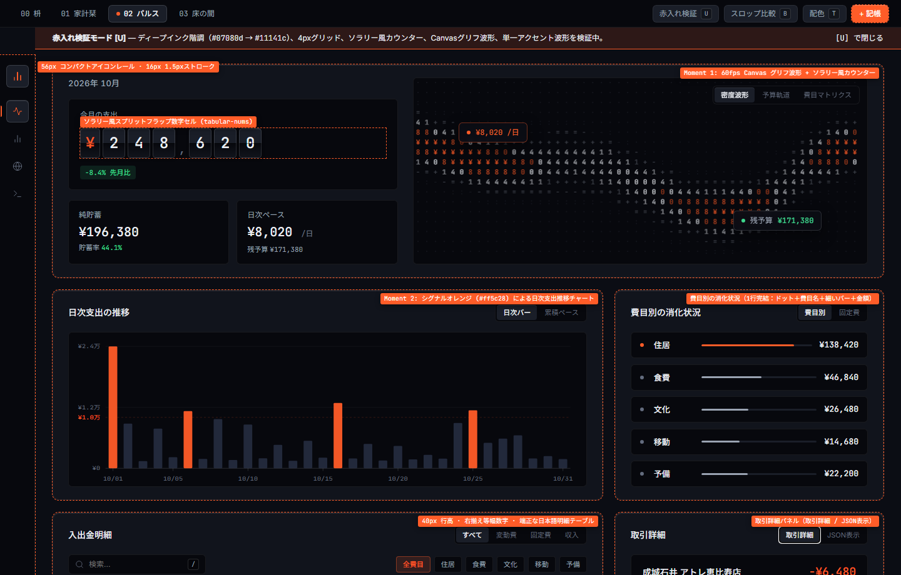

---

## `03` Tokonoma (床の間) — Architectural Swiss Grid

- **Live Demo**: **[Open 03 Tokonoma in Browser ↗](/unslop-kakeibo-showcase/demo/concepts/tokonoma/index.html){target="_blank"}**
- **Character**: `architectural, serene, structural`
- **World**: White shikkui plaster walls, exposed `1px` structural architectural lines, the contemplative negative space (*Ma*) of a Japanese *tokonoma* alcove, and a single vermilion hanko seal impression.
- **Surface Palette**:
  - Light Mode (Default): Alabaster Plaster (`#f4f3ef` canvas, `#1c1b18` sumi ink, `#c83e2b` vermilion seal)
  - Dark Mode: Sumi Charcoal (`#121210` canvas, `#e8e6df` bone ink)
- **Moment 1 — Monumental Serif Statement & Vermilion Seal**: Generous asymmetric negative space surrounds a monumental serif monthly expenditure figure (`¥284,620`), authenticated by a single vermilion seal (`済`).
- **Moment 2 — Architectural Floor-Plan (*Madori*) Treemap**: Instead of conventional progress bars, the five budget categories are proportioned into a 5-room architectural floor plan showing each category's share of total living space (`住居・固定費 41%`, `食費・日用品 24%`, etc.).
- **Signature**: Edge-to-edge exposed `1px` structural gridlines with zero card border-radius and zero drop shadows, paired with Dandelion-inspired mindful expense classification (`理想の暮らし 84%` / `必要経費 11%` / `見直し対象 5%`).

### Screenshots (03 Tokonoma)

#### 1. Architectural Grid — Alabaster Light Mode (`shot-03-tokonoma-1-overview-light.png`)

#### 2. Architectural Grid — Sumi Dark Mode (`shot-03-tokonoma-2-overview-dark.png`)
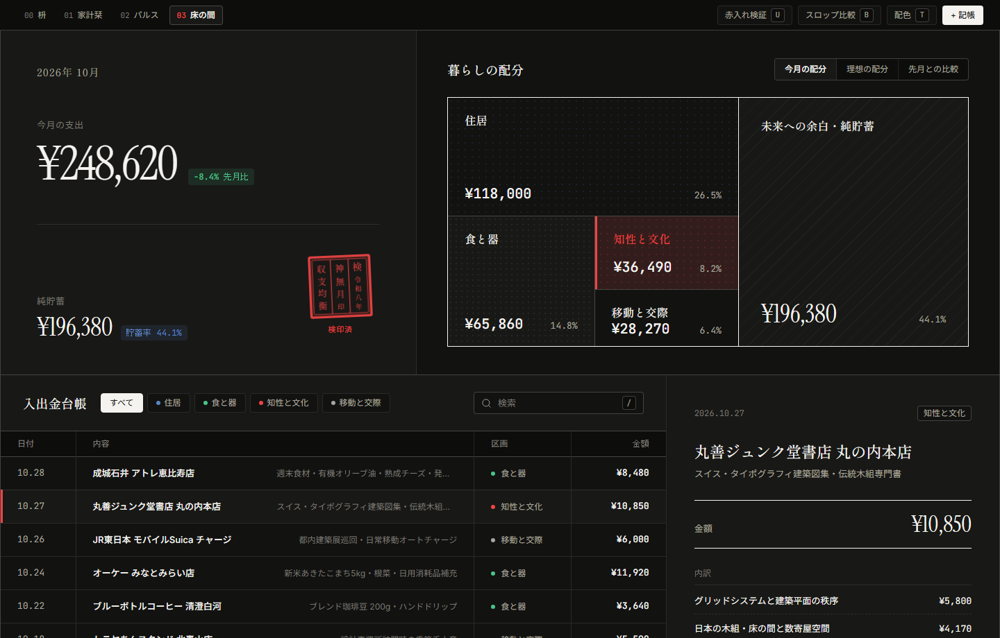

#### 3. Mindful Classification Filter (`理想の暮らし`) (`shot-03-tokonoma-3-ideal-filter.png`)
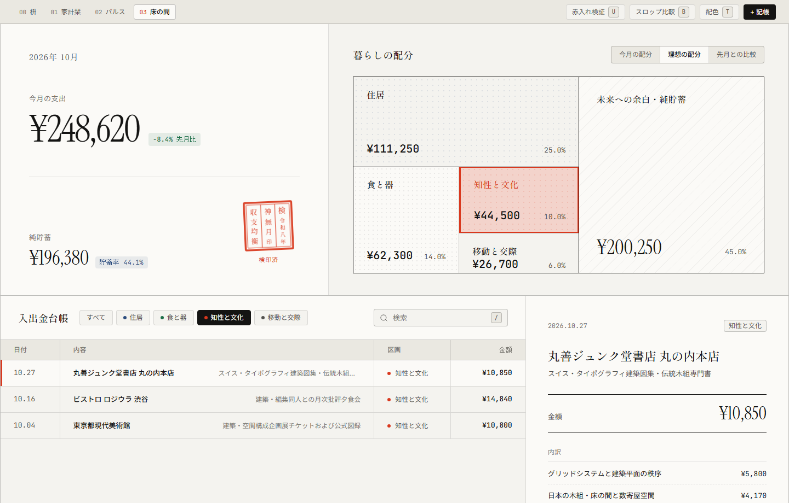

#### 4. Unslop X-Ray Redline Inspection (`shot-03-tokonoma-4-xray-or-modal.png`)
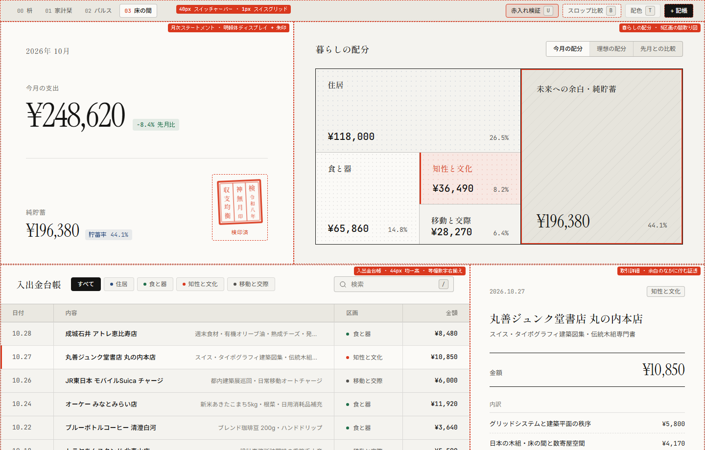
