# 4つのコンセプトと全画面一覧

4つの家計簿アプリケーションはすべて、外部ライブラリに依存しない単体の HTML / CSS / JavaScript として構築されており、ブラウザ上でそのまま操作できます。画面最上部の **コンセプト切替バー** から、ワンクリックで4つの世界を行き来できます。

---

## `00` 枡 (Masu) — 静謐なグラファイト台帳

- **ライブデモ**: **[00 枡 (Masu) をブラウザで開く ↗](/unslop-kakeibo-showcase/demo/index.html){target="_blank"}**
- **Character**: `calm, exact, tactile`（静謐、精確、手触りのある質感）
- **World**: 黒鉛（グラファイト）の筆記具、刷りたての感熱紙レシート、真鍮とブラッシュドメタルの決済カード、日本の木枡（ます）の端正な区切り。
- **サーフェス配色**:
  - ダークモード（既定）: Quiet Graphite（`#0f0f10` キャンバス、`#141415` サイドバー、`#19191b` カード面、`#232325` 1px境界線）
  - ライトモード: Warm Ledger Paper（`#f2efe9` キャンバス、`#f7f4ee` サイドバー、`#fdfbf7` カード面）
- **Moment 1 — 物理決済カードと感熱紙レシート**: 上段の主要カード（`今月の支出`）右側に配置された、重なり合う2枚の物理決済カード（ブラッシュドメタル＋EMV金銀ICチップ＋等幅刻印 `•••• 4821`）と、その奥から覗く感熱紙レシートのミシン目。
- **Moment 2 — 5費目ミラーリング・スプライン曲線**: 5つの主要費目（住居・固定費 `#f5b82e`、食費・日用品 `#10b981`、交際・文化 `#3b82f6`、交通・移動 `#ec4899`、特別・予備 `#8b5cf6`）の `6px` カラードットと完全連動した5本の滑らかな3次ベジェ曲線（上半分）と、0ベースライン下に反転ミラーリングされた前月比較曲線。
- **Signature**: 角丸 `4px` の控えめなキーキャップバッジ（`⌘K`, `N`, `1`〜`4`, `U`, `B`, `T`）と、サイドバーから明細行まで一貫する `6px` の費目ドット。

### スクリーンショット一覧 (00 枡)

#### 1. 概要画面 — ダークモード (`shot-00-masu-1-overview-dark.png`)
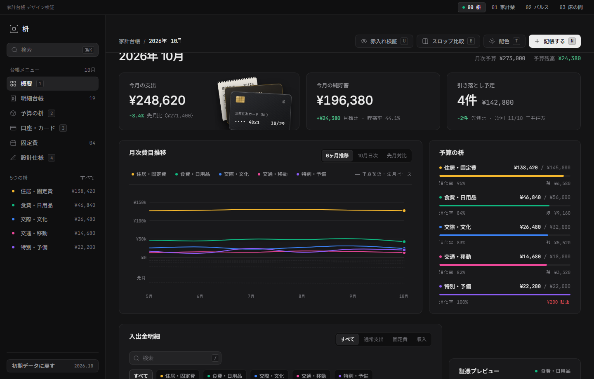

#### 2. 概要画面 — ライトモード (`shot-00-masu-2-overview-light.png`)
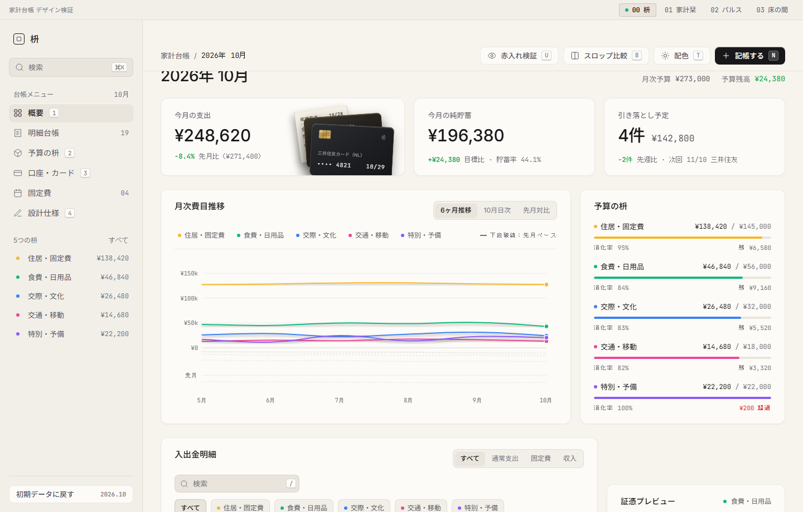

#### 3. 決済カード・連携口座ビュー (`shot-00-masu-3-cards-view.png`)
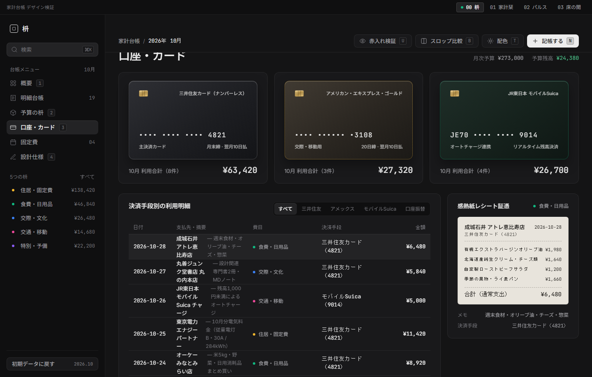

#### 4. 赤入れ検証モード (Unslop X-Ray) (`shot-00-masu-4-envelopes-or-modal.png`)
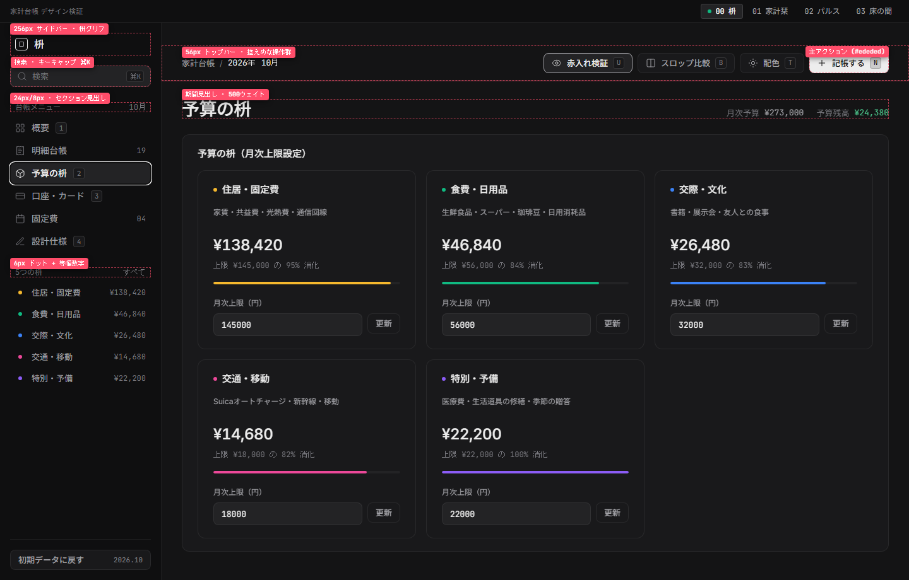

---

## `01` 家計栞 (Kakei Shiori) — 書斎のコットン紙台帳

- **ライブデモ**: **[01 家計栞 (Kakei Shiori) をブラウザで開く ↗](/unslop-kakeibo-showcase/demo/concepts/shiori/index.html){target="_blank"}**
- **Character**: `warm, literary, unhurried`（温かみ、書物的、ゆったりとした時間）
- **World**: 厚手のコットン紙に滲む万年筆のインク、見開き2ページの帳面、真鍮のペーパークリップ、銅版画の植物標本チケット、深紅の布製栞紐。
- **サーフェス配色**:
  - ライトモード（既定）: Archival Cotton（`#f7f4ee` 見開き背景、`#fdfbf7` 紙面、`#1f1e1b` セピア墨インク）
  - ダークモード: Midnight Study（`#141311` 書斎デスク、`#1c1a17` 紙面、`#ece7df` 羊皮紙インク）
- **Moment 1 — 真鍮クリップ留めの銅版画ボタニカル証憑**: 見開き右頁に配置された、選択中の取引明細を活版印刷の証憑チケットとして表現するインスペクタ。上部には真鍮クリップ、下部には銅版画調のボタニカル挿絵が添えられます。
- **Moment 2 — 10月のみ万年筆グリーンで塗られた季節棒グラフ**: 6ヶ月間（`5月`〜`10月`）の月次支出推移のうち、過去5ヶ月を控えめな石色に抑え、当月（`10月`）の1本だけを万年筆のビリジアングリーン（`#1e4d3b`）で際立たせたチャート。
- **Signature**: 画面右上に垂れ下がる深紅の布製「栞紐（`栞`）」。クリックすると赤入れ検証モード（X-Ray）が切り替わります。

### スクリーンショット一覧 (01 家計栞)

#### 1. 見開き台帳 — コットン紙ライトモード (`shot-01-shiori-1-spread-light.png`)
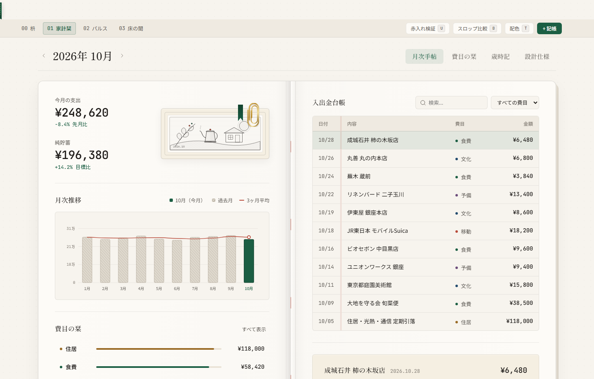

#### 2. 見開き台帳 — 書斎ダークモード (`shot-01-shiori-2-spread-dark.png`)
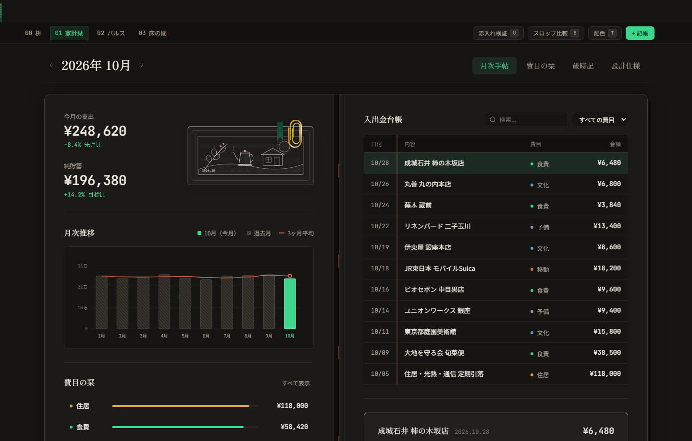

#### 3. 予算の封筒（費目別進捗）タブ (`shot-01-shiori-3-envelopes-tab.png`)
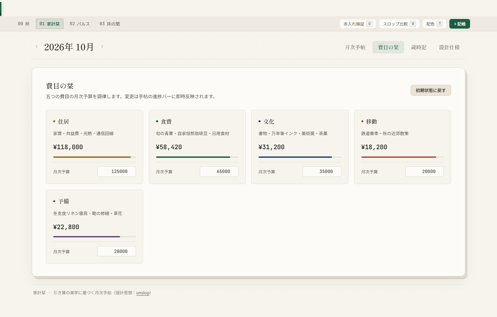

#### 4. 赤入れ検証モード (Unslop X-Ray) (`shot-01-shiori-4-xray-or-modal.png`)
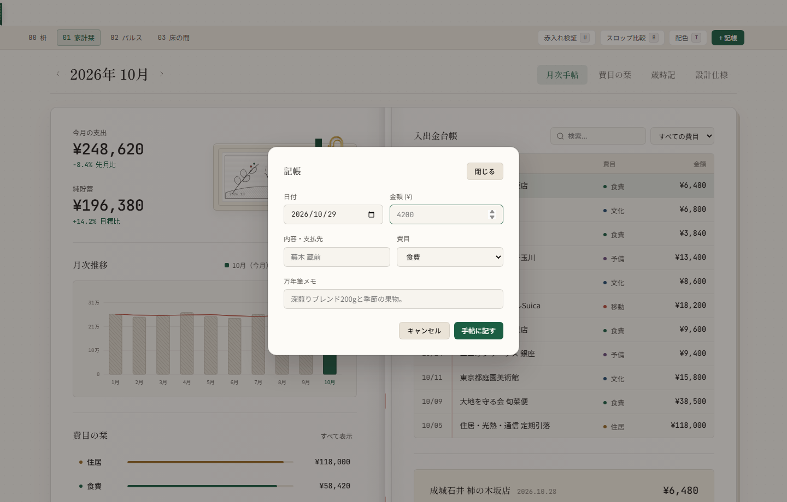

---

## `02` パルス (Pulse) — 高精度テレメトリ台帳

- **ライブデモ**: **[02 パルス (Pulse) をブラウザで開く ↗](/unslop-kakeibo-showcase/demo/concepts/pulse/index.html){target="_blank"}**
- **Character**: `technical, high-precision, atmospheric`（技術的、高精度、静かな緊張感）
- **World**: スタジオ音響スペクトラムアナライザ、高精度オシロスコープ、反転フラップ式（パタパタ時計）表示器、黒アルマイト加工の計測パネル。
- **サーフェス配色**:
  - ダークモード（既定）: Deep Ink（`#0a0b0d` シャーシ、`#101216` モジュール面、`#ff5722` 単一シグナルオレンジ）
  - ライトモード: Clean Lab Ceramic（`#f3f4f6` シャーシ、`#ffffff` モジュール面）
- **Moment 1 — Canvas 2D オシロスコープ波形とパタパタ時計**: 支出リズムをリアルタイムに描く正弦波オシロスコープと、月次支出総額を一桁ずつ刻む機械式スプリットフラップ表示器。
- **Moment 2 — 31日間のシグナルオレンジ・インパルス波形**: 10月1日〜31日の日次支出をシグナルオレンジ（`#ff5722`）の垂直インパルス棒としてプロットし、背後の累積支出曲線と重ねることで「無支出日（9日）」と支出スパイクを一目で把握できるチャート。
- **Signature**: 幅 `56px` の極細左アイコンレール（`16px` 単色SVGアイコン＋キーキャップツールチップ `1`〜`4`）と等幅フォントの計測グリッド。

### スクリーンショット一覧 (02 パルス)

#### 1. テレメトリ概要 — ディープインク・ダークモード (`shot-02-pulse-1-overview-dark.png`)
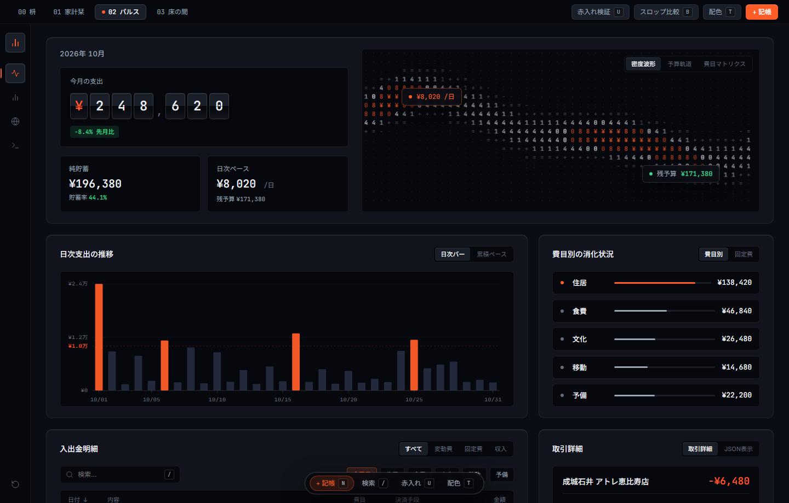

#### 2. テレメトリ概要 — ラボセラミック・ライトモード (`shot-02-pulse-2-overview-light.png`)
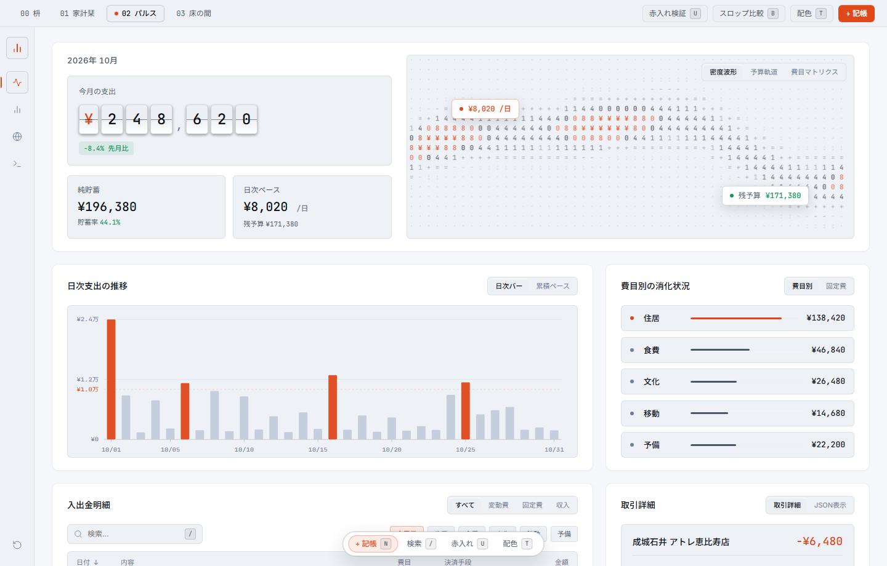

#### 3. 日次支出の推移・JSONデータビュー (`shot-02-pulse-3-trajectory-json.png`)
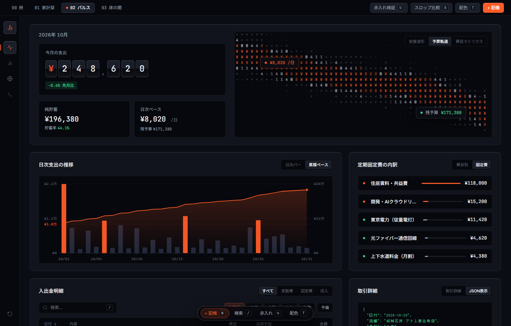

#### 4. 赤入れ検証モード (Unslop X-Ray) (`shot-02-pulse-4-xray.png`)
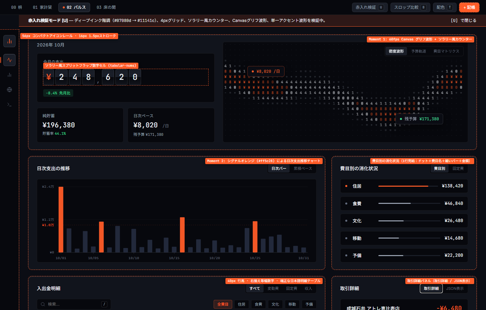

---

## `03` 床の間 (Tokonoma) — 建築的スイスグリッド台帳

- **ライブデモ**: **[03 床の間 (Tokonoma) をブラウザで開く ↗](/unslop-kakeibo-showcase/demo/concepts/tokonoma/index.html){target="_blank"}**
- **Character**: `architectural, serene, structural`（建築的、静寂、構造美）
- **World**: 漆喰の白壁、露出する `1px` の建築構造グリッド、日本の「床の間」が持つ余白（間）、そして一点の朱印。
- **サーフェス配色**:
  - ライトモード（既定）: Alabaster Plaster（`#f4f3ef` 漆喰キャンバス、`#1c1b18` 墨色、`#c83e2b` 朱印）
  - ダークモード: Sumi Charcoal（`#121210` 墨キャンバス、`#e8e6df` 生成り文字）
- **Moment 1 — 大判明朝体の月次支出額と一滴の朱印**: 贅沢な余白の中に鎮座する大判明朝体の月次支出額（`¥284,620`）と、その傍らに押された一滴の朱印スタンプ（`済`）。
- **Moment 2 — 建築図面「暮らしの間取り図」ツリーマップ**: 従来の棒グラフではなく、5つの予算費目を「暮らしの空間配分（住居・固定費 41%、食費・日用品 24% など）」として比例面積で区画した建築間取り図ツリーマップ。
- **Signature**: 角丸とドロップシャドウを一切排した端から端まで貫通する `1px` の露出構造グリッドと、支出の意味を問い直す3つの価値フィルタ（`理想の暮らし 84%` / `必要経費 11%` / `見直し対象 5%`）。

### スクリーンショット一覧 (03 床の間)

#### 1. 建築グリッド台帳 — 漆喰ライトモード (`shot-03-tokonoma-1-overview-light.png`)
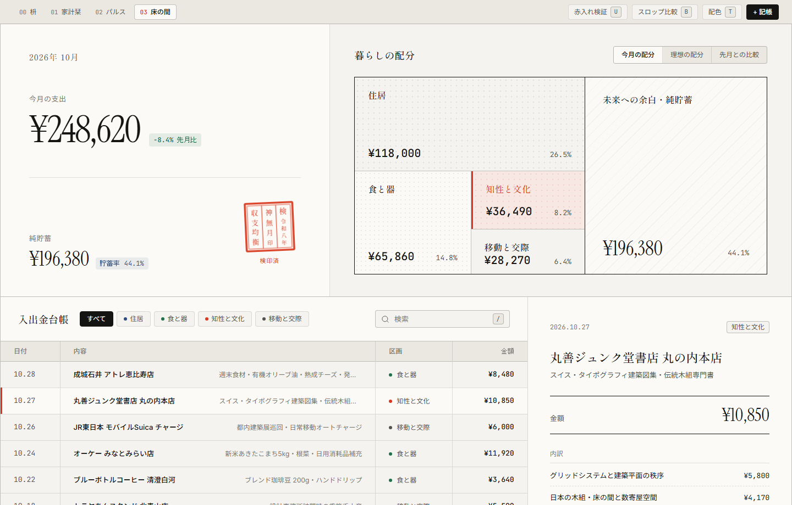

#### 2. 建築グリッド台帳 — 墨ダークモード (`shot-03-tokonoma-2-overview-dark.png`)
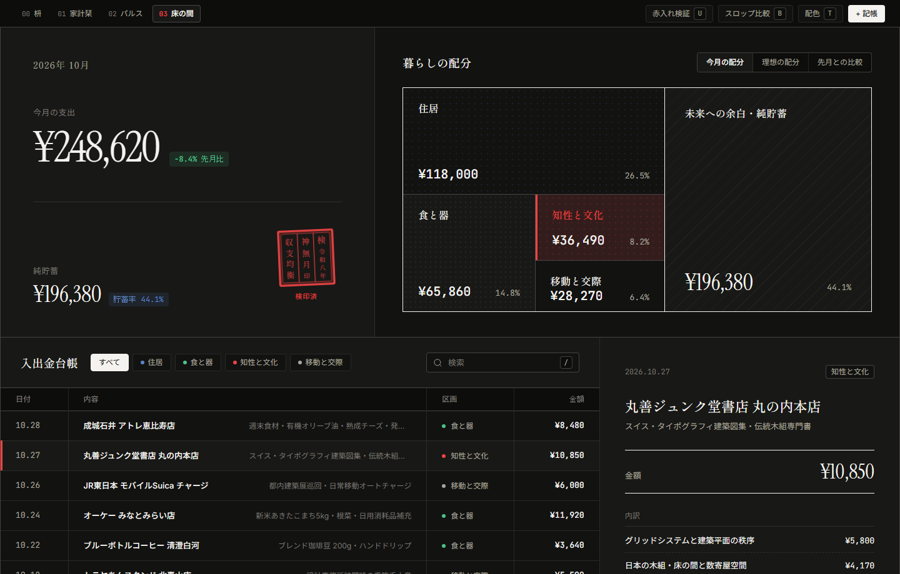

#### 3. 価値基準フィルタ（「理想の暮らし」絞り込み） (`shot-03-tokonoma-3-ideal-filter.png`)
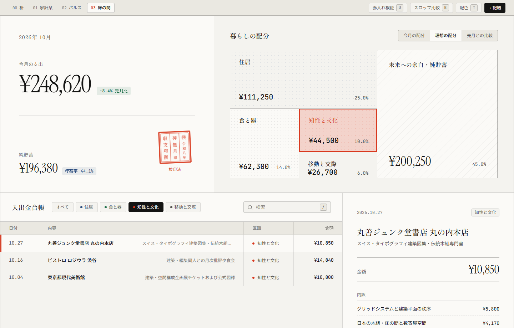

#### 4. 赤入れ検証モード (Unslop X-Ray) (`shot-03-tokonoma-4-xray-or-modal.png`)
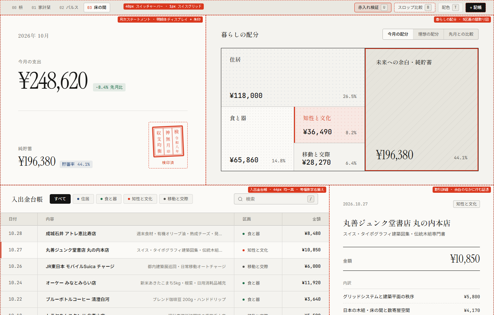
